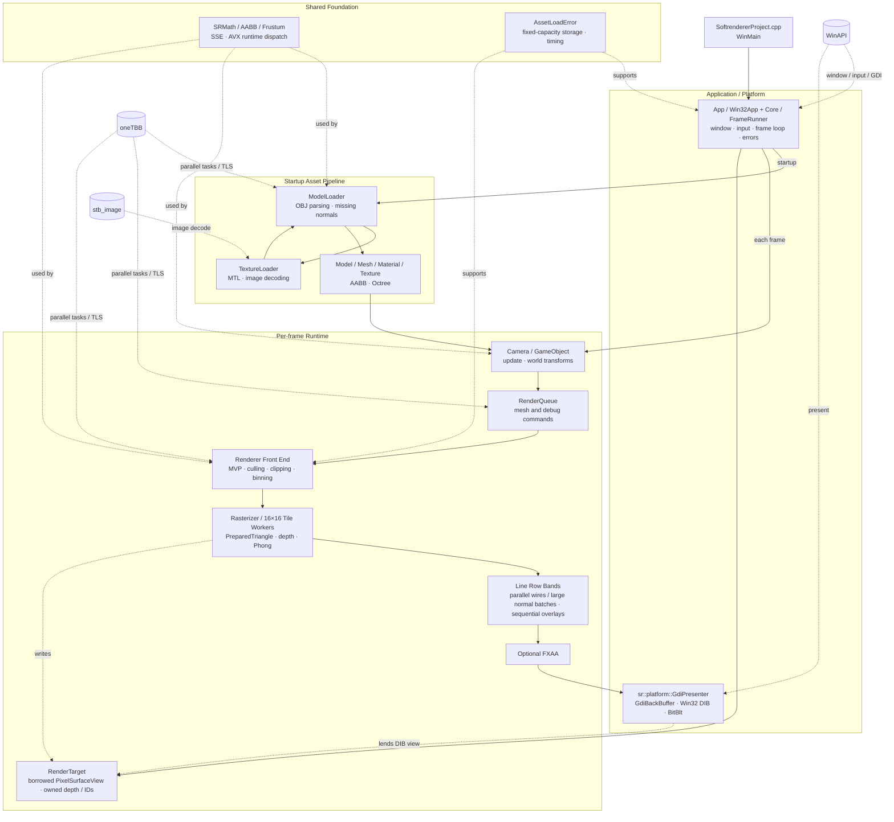

# Architecture / 아키텍처 / アーキテクチャ

[한국어](#한국어) · [English](#english) · [日本語](#日本語)

[README 한국어](README.md) · [README English](README.en.md) · [README 日本語](README.ja.md)

This document describes the architecture that is implemented in the repository today. Component names in the diagrams match the source tree so that each box can be traced back to code.

## System map



## Frame flow

```mermaid
sequenceDiagram
    participant OS as Win32
    participant F as Win32App + FrameRunner
    participant S as Scene / SceneRenderCollector
    participant Q as RenderQueue
    participant R as Renderer
    participant T as oneTBB workers
    participant B as RenderTarget
    participant G as GdiPresenter

    OS->>F: messages and input
    F->>S: Update(deltaTime)
    S->>Q: frustum/octree culling and command submission
    F->>B: Clear color / depth / primitive IDs
    F->>R: RenderScene(target, queue, viewParams, lights)
    R->>T: transform, clip, prepare once, append worker-flat references / counts
    T-->>R: join; freeze pools, references, and active-worker list
    R->>R: count prefix / tile offsets / disjoint worker ranges
    R->>T: worker-parallel scatter into one pointer array
    T-->>R: scatter join
    R->>T: optional sort within each tile span
    opt hiddenWireframe enabled and any wireframe command
        R->>T: depth-only pass over all faces
        T-->>B: completed depth / primitive IDs
    end
    R->>T: shaded fill in independent 16×16 tiles
    T-->>B: depth-tested color results
    R->>T: X-ray or hidden wires in disjoint Y-row bands
    T-->>B: band-limited color writes (depth / IDs read-only)
    T-->>R: wire workers join
    R->>T: DepthTested lines: parallel preparation / row bands if count >= 256
    T-->>B: original-order color writes (small batches: sequential)
    T-->>R: join
    R->>B: sequential overlays
    opt FXAA enabled
        R->>T: luminance pass and filter pass
        T-->>B: filtered active pixels (padding preserved)
    end
    F->>G: Present(screen DC)
    G->>OS: BitBlt + GdiFlush before CPU reuse
```

---

## 한국어

### 구조의 목적

이 프로젝트는 GPU API에 래스터화를 맡기지 않고, OBJ 자산을 읽어 장면을 구성한 뒤 정점 처리부터 픽셀 출력까지 CPU에서 수행합니다. `Win32App`이 창과 입력을, 플랫폼 무관한 `FrameRunner`가 프레임 순서를 맡고, `SceneRenderCollector`가 장면에서 한 프레임 동안 유효한 렌더 명령을 만들며, `Renderer`가 명령을 타일 단위 작업으로 바꿔 병렬 실행합니다.

### 계층별 책임

| 계층 | 주요 코드 | 책임 |
|---|---|---|
| 진입점·앱 | `SoftrendererProject.cpp`, `src/App/Win32App.*` | 창 생성, 메시지 루프, 메뉴·입력, 프레임 시간, 오류 메시지, Present |
| 프레임 코어 | `src/Core/FrameRunner.*`, `src/Core/SceneRenderCollector.*` | 프레임 시작 훅 → Scene 갱신 → 가시성 수집(RenderQueue) → Clear → RenderScene. 창 앱·srcli·골든 테스트가 같은 경로를 쓴다 |
| 데모·headless | `src/Core/DemoScene.*`, `src/Core/HeadlessRunner.*`, `tools/srcli` | 벤치·골든용 고정 장면 구성, 창 없는 렌더링·벤치마크·PNG 저장 |
| 자산·그래픽스 | `src/Graphics` | OBJ/MTL/이미지 로드, 누락 법선 생성, `Model`·`Mesh`·`Material`·`Texture` 구성, AABB와 octree 생성 |
| 장면 | `src/Scene` | `Scene`(루트 물체·광원·카메라), 카메라와 frustum 갱신, 게임 오브젝트 계층과 월드/법선 행렬 갱신. 렌더 명령은 모른다 |
| 제출 경계 | `RenderCommand.h`, `RenderQueue.h` | 장면 데이터와 렌더러 사이의 한 프레임짜리 명령 버퍼 제공 |
| CPU 렌더러 | `src/Renderer` | 정점 변환, back-face culling, clipping, 타일 binning, 래스터화, 깊이 검사, Phong 조명, 디버그 선, FXAA |
| 수학·공통 기반 | `src/Math`, `src/Utils` | 벡터/행렬, AABB/Frustum, SSE/AVX 선택, 고정 용량 버퍼, 구조화 오류, 성능 측정 |
| 플랫폼·외부 코드 | `src/Platform`, `src/ThirdParty` | Win32 헤더 경계와 GDI 수명 관리, oneTBB 병렬 실행, stb_image 이미지 디코딩 |

### 시작 시 자산이 장면이 되는 과정

1. `Win32App::initializeScene`이 실행 파일 기준 `assets` 경로로 `sr::demo::LoadScene`을 호출하고, 장면 표의 모델마다 `ModelLoader::LoadOBJ`를 호출합니다.
2. `ModelLoader`는 `std::filesystem::path`로 OBJ를 열고, `std::string_view`와 `std::from_chars` 중심으로 정점·텍스처 좌표·법선·면·material 사용 정보를 읽습니다.
3. MTL이 참조되면 `TextureLoader`가 material의 색상·광택 값을 읽습니다. 이미지는 별도의 `LoadImageFile` API로 디코딩하며, 현재 MTL의 `map_Kd`를 자동 연결하지는 않습니다.
4. 누락된 법선을 생성하고 mesh별 AABB와 octree를 구성합니다. 독립적인 mesh 후처리는 oneTBB로 병렬화됩니다.
5. 성공하면 `std::unique_ptr<Model>`이 `GameObject`로 이동합니다. 실패하면 `AssetLoadError`가 `std::expected`를 통해 `Win32App`으로 전달되고, UI 계층에서만 `MessageBoxW`로 바뀝니다.

### 한 프레임이 그려지는 과정

1. `Win32App::Run`이 Win32 메시지를 처리하고 `steady_clock` 기반 성능 측정값을 갱신합니다.
2. `FrameRunner::Update`가 프레임 시작 훅을 부르고 `RenderQueue`를 비운 뒤 `Scene::Update`로 카메라와 게임 오브젝트 transform을 갱신합니다.
3. `SceneRenderCollector`가 `GameObject` AABB와 `Octree::ForEachVisibleNode` 질의를 통과한 mesh 또는 node만 `MeshRenderCommand`로 제출합니다. 와이어프레임은 명령의 rasterize mode로 지정하고, 선택된 법선·AABB·광원 방향 정보는 debug command로 제출합니다.
4. `RenderTarget::Clear` 후 `Renderer::RenderScene(target, ...)`이 정점 변환, back-face culling, 6개 frustum plane clipping을 수행합니다. 각 결과의 화면 좌표·역깊이·보간 속성·경계·edge 계산을 `PreparedTriangle`로 한 번 준비해 16×16 tile bin에서 공유합니다.
5. `Rasterizer`가 서로 다른 tile에 reciprocal-depth test, 원근 보정, texture sampling과 Phong 조명을 적용합니다. 큰 `1/w`가 가깝고 정확히 같은 깊이는 작은 primitive ID가 이깁니다. 기본 `hiddenWireframe=false`에서는 채움 명령만 면을 래스터화하므로 와이어 면은 깊이를 만들거나 채움 면을 가리지 않습니다. 옵션 ON이면서 와이어 명령이 있을 때만 모든 면의 depth-only 패스를 선행하고 보이는 채움 픽셀을 셰이딩합니다.
6. 기본 와이어는 빠른 X-ray 선이며 깊이를 무시합니다. 숨은 와이어 옵션 ON일 때만 면 깊이를 읽어 숨은 선을 제거합니다. 와이어를 서로 다른 Y행 band에서 병렬 처리하고 join한 뒤 법선, 오버레이 순서로 실행합니다. 큰 법선 묶음은 준비·행 쓰기를 병렬화하고 작은 묶음과 오버레이는 순차 처리합니다. 법선은 독립적인 DepthTested 정책으로 기존 면 깊이를 검사합니다. 옵션 OFF에서는 채움 면 깊이만 존재하므로 순수 와이어 장면의 법선은 면에 가려지지 않습니다. 깊이를 검사하는 선은 공통 수치 여유를 쓰며 깊이·ID를 수정하지 않습니다. AABB·광원은 깊이를 무시하는 오버레이입니다.
7. FXAA가 켜져 있으면 활성 픽셀 snapshot과 luminance/filter pass를 실행하고 padding은 보존합니다. `GdiPresenter::Present`가 이미 DIB에 기록된 픽셀을 `BitBlt`로 표시하고, `GdiFlush` 후 다음 CPU 프레임이 버퍼를 재사용합니다.

### 병렬 처리와 SIMD 경계

- oneTBB는 mesh 명령 생성, renderer front-end, tile rasterization, 와이어·큰 법선 묶음, FXAA에 사용됩니다. 선은 `min(32, ceil(height / 64))`개 band로 나누고 각 작업이 서로 겹치지 않는 `[minY, maxY)` 행의 색상만 씁니다. 와이어 join 뒤 DepthTested 선이 256개 이상이면 256-line chunk로 변환·클리핑을 병렬 준비합니다. 원본 순번 슬롯에서 제출 순서대로 bin을 만들고 불변 준비 결과를 행 worker가 공유합니다. 256개 미만은 순차 fallback이며 오버레이는 법선 join 뒤 순차 실행합니다.
- 와이어 단계의 삼각형 풀은 front-end 종료 후 읽기 전용이고, 깊이·primitive ID도 읽기 전용입니다. `BeginLineRows`는 화면으로 clamp한 쓰기 범위만 바꿉니다. 선을 band 경계에서 clip하거나 새 끝점으로 재시작하지 않고 원래 Bresenham/DDA 진행을 유지하므로 반올림·기울기 bias·경계 픽셀 규칙이 보존됩니다. 완전히 겹치지 않는 Y 범위의 선만 건너뛰고, 통계는 band별로 모아 join 뒤 합칩니다.
- Front-end의 clip buffer, 정점 캐시, stamp와 triangle pool은 worker별 `WorkerScratch`에 분리됩니다. 현재 프레임의 마지막 메시·정점 저장소·world/VP 비트·모드 키가 일치할 때만 정점 결과와 MVP/법선 행렬을 재사용합니다. 캐시 miss는 새 stamp와 변환 행렬을 준비하며 `BeginFrame`은 캐시를 무효화합니다. 자세한 키·실패 복구 계약은 [유지보수 문서](MAINTENANCE.md)를 따릅니다.
- 삼각형 풀은 worker별 `concurrent_vector`를 유지하고 참조는 flat `tileReferences`에 기록합니다. `tileScatter`는 타일별 count/cursor를, `touchedTileIds`는 초기화할 타일을 보관합니다. Front-end join 뒤 활성 worker 목록을 고정하고 prefix offset으로 worker별 목적 구간을 배정합니다. 병렬 scatter가 단일 최종 포인터 배열을 채우고 join한 뒤 각 tile span에서 선택적 정렬·래스터화를 수행합니다. 픽셀 소유권·primitive ID와 서로 겹치지 않는 화면 쓰기 규칙은 그대로이며 별도 JobSystem은 없습니다. 기본 빠른 X-ray만 있는 장면은 flat 타일 참조·worker 메타데이터의 신규 할당과 depth prepass를 건너뜁니다.
- 타일별 vector capacity 누적을 없애고 worker별 flat/최종 포인터 배열을 재사용합니다. `binReferences`는 논리 참조만 한 번 세며, `retainedBinBytes`는 flat/최종/wire/debug 저장소, count/cursor/offset, 헤더, touched/활성 목록을 포함합니다. `binMs`는 front-end 참조 준비, `rasterMs`는 prefix/scatter/정렬/래스터화를 포함합니다. 비교 측정은 진행 중이며 속도 개선이나 최종 채택을 단정하지 않습니다.
- 병렬로 만든 메시별 command batch는 메시 순서대로 병합합니다. 객체·옥트리 순서와 원본 삼각형·clipping fan 순번으로 ID를 정하고, worker 순서나 주소를 ID로 쓰지 않습니다. front-to-back 옵션은 각 bin을 최대 역깊이 내림차순·ID 오름차순으로 정렬합니다.
- 정렬·Hi-Z는 독립된 실험 옵션이며 둘 다 기본 꺼짐입니다. Hi-Z는 현재 프레임의 자기 타일 깊이만 요약하고, 완전히 채워진 영역에서 확실히 뒤인 후보만 기각합니다. 이전 프레임/다른 타일을 읽지 않으며 동일 깊이·구멍·불확실한 값은 보수적으로 통과시킵니다. 상세 계측도 선택적이며 최종 시간 비교에서는 끕니다.
- 단일 `vec4`에 정확히 맞는 연산은 128-bit SSE 경로를 유지합니다. 같은 행렬로 두 `vec4`를 처리하는 `transform_pair`만 8개의 float을 256-bit AVX에 채웁니다.
- AVX 코드는 별도 translation unit에서 `/arch:AVX`로 컴파일됩니다. 기본 translation unit이 CPUID, OSXSAVE와 XCR0을 검사한 뒤 함수 포인터를 SSE 또는 AVX 구현에 연결하므로 AVX를 지원하지 않는 CPU에서도 기본 경로를 실행할 수 있습니다.

### 소유권과 한 프레임 계약

- `Win32App`은 `GdiPresenter`, `RenderTarget`, `FrameRunner`(Scene·RenderQueue·`unique_ptr<Renderer>` 소유)를 이 순서로 선언해 역순 파괴를 보장합니다. 루트 `GameObject`는 `shared_ptr`, 각 객체의 `Model`은 `unique_ptr`로 소유합니다.
- `Model`은 mesh 배열을 소유하고, 각 `Mesh`는 정점·인덱스·material·octree를 소유합니다. Texture는 material 사이에서 `shared_ptr`로 공유될 수 있습니다.
- `MeshRenderCommand`의 mesh/material 포인터와 index `span`은 소유하지 않습니다. 원본 `GameObject`와 `Model`이 프레임의 `RenderQueue`보다 오래 산다는 조건으로 유효합니다.
- `DebugPrimitiveCommand`는 생성된 debug vertex를 값으로 소유합니다. `RenderQueue::Clear`가 다음 프레임 시작 전에 두 명령 배열을 비웁니다.
- `sr::platform::GdiBackBuffer`는 memory DC, DIB와 이전 선택 객체를 이동 전용 RAII로 관리하고, resize와 종료 때 올바른 순서로 복원·해제합니다.
- `GdiPresenter`가 GDI 백버퍼를 소유합니다. `PixelSurfaceView`는 top-down BGRX `span`, width/height, 픽셀 단위 stride를 빌립니다. `RenderTarget`만 tight depth/64-bit primitive ID 버퍼를 소유하며 색상 stride와 깊이 index를 혼용하지 않습니다.
- resize 전에 동기 작업을 마치고 target을 `Detach`합니다. presenter가 새 DIB를 만든 후 `Attach`가 크기·stride·최종 접근 범위·overflow·할당을 확인합니다. 실패는 `expected`로 전달하고 빈 상태로 남으며, 한 축이 0인 target도 정상적인 no-op입니다. 프레임 밖에 target 포인터를 저장하지 않습니다.

### 현재의 경계와 제한

- `Renderer`/`RenderTarget`/`Rasterizer`는 Win32 표시와 분리되어 일반 메모리로 테스트할 수 있습니다. 코어와 `srcli`·테스트는 CMake로 GCC에서도 빌드되며, 창 앱은 Windows/MSVC 전용입니다. Win32 handle은 Win32App과 표시 계층에 남습니다.
- 기존 FXAA는 BGRX의 하위 바이트를 red로 해석해 red/blue 휘도 가중치가 뒤바뀌어 있습니다. 구조 변경 중 픽셀 기준을 바꾸지 않기 위해 유지했으며 별도 수정 과제로 기록합니다.
- 기본 X-ray 와이어와 선택적인 숨은 와이어는 동작·비용이 다릅니다. `hiddenWireframe`을 고정한 상태에서만 정렬/Hi-Z OFF→ON을 비교합니다. 법선 깊이 정책은 이 옵션과 독립적입니다. 비용·메모리·검증 상태는 [가시성 변경 기록](PERFORMANCE.md#renderer-visibility-2026)에서 구분합니다.
- `src/Modules/sr.math.ixx`는 `import std;`와 math concept를 검증하는 named-module 경계입니다. 전체 프로젝트가 모듈만으로 구성된 것은 아니며, 나머지 자체 코드는 현재 헤더/소스 구조를 유지합니다.
- C++26 `std::inplace_vector`가 도구체인에 없으면 같은 고정 용량 계약을 제공하는 내부 fallback을 사용합니다.

---

## English

### Purpose of the architecture

This project does not delegate rasterization to a GPU API. It loads OBJ assets, builds a scene, and performs the pipeline from vertex processing through pixel output on the CPU. `Win32App` owns the window and input, the platform-independent `FrameRunner` owns frame order, `SceneRenderCollector` turns the scene into commands that are valid for that frame, and `Renderer` converts those commands into parallel tile work.

### Layer responsibilities

| Layer | Main code | Responsibility |
|---|---|---|
| Entry and app | `SoftrendererProject.cpp`, `src/App/Win32App.*` | Create the window; process messages, menus and input; track frame time; present user-facing errors; Present |
| Frame core | `src/Core/FrameRunner.*`, `src/Core/SceneRenderCollector.*` | Frame-start hook → scene update → visibility collection (RenderQueue) → Clear → RenderScene. The window app, srcli, and golden tests share this path |
| Demo and headless | `src/Core/DemoScene.*`, `src/Core/HeadlessRunner.*`, `tools/srcli` | Build the fixed benchmark/golden scene; windowless rendering, benchmarks, PNG output |
| Assets and graphics | `src/Graphics` | Load OBJ/MTL/images; generate missing normals; build `Model`, `Mesh`, `Material`, and `Texture`; construct AABBs and octrees |
| Scene | `src/Scene` | Update the camera and frustum; maintain object transforms and hierarchy; submit visible objects as render commands |
| Submission boundary | `RenderCommand.h`, `RenderQueue.h` | Provide a frame-scoped command buffer between scene data and the renderer |
| CPU renderer | `src/Renderer` | Transform vertices; back-face cull; clip; bin into tiles; rasterize; depth test; apply Phong lighting; draw debug lines; run FXAA |
| Math and utilities | `src/Math`, `src/Utils` | Supply vectors/matrices, AABB/Frustum math, SSE/AVX selection, fixed-capacity storage, structured errors, and timing |
| Platform and vendors | `src/Platform`, `src/ThirdParty` | Centralize Win32 includes and GDI ownership; provide oneTBB tasking and stb_image decoding |

### Startup asset path

1. `Win32App::initializeScene` passes the executable-relative `assets` path to `sr::demo::LoadScene`, which calls `ModelLoader::LoadOBJ` for each model in the scene table.
2. `ModelLoader` opens the OBJ through `std::filesystem::path` and parses positions, texture coordinates, normals, faces, and material usage primarily with `std::string_view` and `std::from_chars`.
3. `TextureLoader` reads material colors and shininess from MTL. Image decoding uses the separate `LoadImageFile` API; MTL `map_Kd` is not automatically connected today.
4. Missing normals are generated, then per-mesh AABBs and octrees are constructed. Independent mesh post-processing is parallelized with oneTBB.
5. On success, the `std::unique_ptr<Model>` moves into a `GameObject`. On failure, `AssetLoadError` travels through `std::expected` to `Win32App`, where—and only where—it becomes a `MessageBoxW`.

### Per-frame path

1. `Win32App::Run` processes Win32 messages and updates its `steady_clock`-based performance measurements.
2. `FrameRunner::Update` runs the frame-start hook, clears the `RenderQueue`, then `Scene::Update` updates the camera and object transforms; `SceneRenderCollector` then submits visible meshes and octree nodes.
3. `GameObject` and `Octree` submit only meshes or nodes that pass AABB/Frustum tests as `MeshRenderCommand` objects. Wireframe is selected through the command's rasterize mode, while normal, AABB, and light-direction visualizations become debug commands.
4. After `RenderTarget::Clear`, `Renderer::RenderScene(target, ...)` transforms vertices, back-face culls, and clips against six frustum planes. Each result prepares screen coordinates, inverse depth, interpolants, bounds, and reusable edge data once in a shared `PreparedTriangle`.
5. `Rasterizer` applies reciprocal-depth tests, perspective correction, texture sampling, and Phong illumination in disjoint tiles. Larger `1/w` is closer; smaller primitive ID wins an exact tie. With default `hiddenWireframe=false`, only fill commands rasterize faces: wire faces neither create depth nor occlude filled faces. Only enabling the option in a frame containing wire commands adds an all-face depth-only pass before shading visible fill pixels.
6. Default wires are fast depth-independent X-ray lines. Hidden wire enables face-depth testing. Wires run in parallel disjoint Y-row bands, then join before normals and overlays. Large normal batches prepare and draw in parallel; small batches and overlays remain sequential. Normals independently retain a DepthTested policy against existing face depth; with the option off, only fill faces produce depth, so pure wire scenes cannot hide normals behind faces. Depth-tested lines use a shared numerical allowance without changing depth/IDs. AABB/light gizmos are depth-independent overlays.
7. Optional FXAA snapshots active pixels and runs luminance/filter passes without touching padding. `GdiPresenter::Present` uses `BitBlt` on the already-rendered DIB and calls `GdiFlush` before the next CPU frame reuses it.

### Parallelism and SIMD boundaries

- oneTBB handles mesh-command generation, the renderer front end, tile rasterization, wires/large normal batches, and FXAA. Lines use `min(32, ceil(height / 64))` bands, each writing color only within its disjoint `[minY, maxY)` rows. After wire workers join, at least 256 DepthTested lines enable parallel transform/clipping preparation in 256-line chunks. Original-index slots feed submission-order bins, and row workers share immutable prepared results. Fewer than 256 lines use the sequential fallback; overlays run sequentially after normal workers join.
- Triangle pools are read-only after the front end finishes; wire depth and primitive IDs are also read-only. `BeginLineRows` changes only the screen-clamped write range. It neither clips endpoints nor restarts a line at the band boundary, retaining the original Bresenham/DDA progression, rounding, slope bias, and edge pixels. Only lines with wholly disjoint Y bounds are skipped; band-local statistics merge after joining.
- Front-end clip buffers, vertex caches, stamps, and triangle pools live in per-worker `WorkerScratch`. Vertex results and MVP/normal matrices are reused only when the current frame's last mesh, vertex-storage, world/VP-bit, and mode key matches exactly. A cache miss prepares a new stamp and transform matrices; `BeginFrame` invalidates the cache. See [maintenance contracts](MAINTENANCE.md) for exact keys and failure recovery.
- Triangle pools retain per-worker `concurrent_vector` storage; references enter flat `tileReferences`. `tileScatter` holds per-tile counts/cursors, and `touchedTileIds` identifies metadata to reset. After the front-end join freezes the active-worker list, prefix offsets assign disjoint worker destination ranges. Parallel scatter fills one final pointer array and joins before optional sorting and rasterization within each tile span. Pixel ownership, primitive IDs, and disjoint screen-write rules are unchanged; no separate JobSystem is added. Pure default fast X-ray skips new flat tile-reference/worker-metadata allocations and the depth prepass.
- Worker-flat and final-pointer capacities are reused instead of accumulating per-tile vector capacity. `binReferences` counts logical references once; `retainedBinBytes` includes flat/final/wire/debug storage, counts/cursors/offsets, headers, and touched/active lists. `binMs` covers front-end reference preparation; `rasterMs` includes prefix, scatter, sorting, and rasterization. Comparisons remain in progress, without a claim of faster performance or final adoption.
- Parallel mesh-command batches merge in mesh order. Object/octree order, source-triangle order, and clipping-fan order determine IDs—not worker scheduling or addresses. Optional front-to-back sorting orders each bin by descending maximum inverse depth, then ascending ID.
- Sorting and Hi-Z are independent experiments, both off by default. Hi-Z summarizes only the current frame's own tile and rejects candidates only when fully covered regions prove them farther away. It reads no earlier frame or other tile; equal depths, holes, and uncertain bounds pass conservatively. Detailed instrumentation is optional and disabled for final timing comparisons.
- Operations that naturally fit one `vec4` stay on the 128-bit SSE path. Only `transform_pair`, which applies one matrix to two `vec4` values, fills all eight float lanes of a 256-bit AVX register.
- AVX code is compiled in a separate translation unit with `/arch:AVX`. A baseline translation unit checks CPUID, OSXSAVE, and XCR0 before binding a function pointer to the SSE or AVX implementation, so unsupported CPUs retain a valid baseline path.

### Ownership and frame contracts

- `Win32App` declares `GdiPresenter`, `RenderTarget`, then `FrameRunner` (which owns the Scene, RenderQueue and `unique_ptr<Renderer>`), ensuring reverse destruction order. Root `GameObject` instances use `shared_ptr`; each uniquely owns one `Model`.
- `Model` owns its mesh array, and each `Mesh` owns its vertices, indices, material, and octree. Materials may share textures through `shared_ptr`.
- The mesh/material pointers and index `span` in `MeshRenderCommand` are non-owning. They remain valid because the source `GameObject` and `Model` outlive the frame's `RenderQueue`.
- `DebugPrimitiveCommand` owns generated debug vertices by value. `RenderQueue::Clear` empties both command arrays before the next frame is submitted.
- `sr::platform::GdiBackBuffer` is a move-only RAII owner for the memory DC, DIB, and previously selected object, restoring and releasing them in the required order during resize and shutdown.
- `GdiPresenter` owns that GDI back buffer. `PixelSurfaceView` borrows a top-down BGRX span, dimensions, and stride measured in pixels. `RenderTarget` owns tight depth/64-bit primitive ID arrays; color stride and depth indexing are separate.
- Before resize, synchronous work finishes and the target detaches. After DIB creation, `Attach` validates dimensions, stride, final access extent, overflow, and allocation. Errors use `expected` and leave an empty target. Either zero axis is a valid no-op. Renderer retains no target pointer beyond a frame.

### Current boundaries and limitations

- `Renderer`, `RenderTarget`, and `Rasterizer` are separate from Win32 presentation and support ordinary-memory tests. The core, `srcli`, and tests also build with GCC through CMake; the windowed app is Windows/MSVC only. Win32 handles remain in Win32App and presentation.
- Existing FXAA interprets the low BGRX byte as red, reversing red/blue luminance weights. It is deliberately retained to preserve the structural refactor's pixel reference and recorded as a separate behavior issue.
- Default X-ray and optional hidden wire differ in behavior and cost. Keep `hiddenWireframe` fixed when comparing sorting/Hi-Z OFF→ON. Normal depth policy is independent. Costs, memory, and validation status are separated in the [visibility change record](PERFORMANCE.md#renderer-visibility-2026).
- `src/Modules/sr.math.ixx` is a named-module boundary that validates `import std;` and math concepts. The entire project is not module-only; the remaining first-party code currently retains its header/source organization.
- When the toolchain does not provide C++26 `std::inplace_vector`, an internal fallback preserves the same fixed-capacity contract.

---

## 日本語

### アーキテクチャの目的

このプロジェクトは、ラスタライズをGPU APIに任せません。OBJアセットからシーンを構築し、頂点処理からピクセル出力までをCPU上で実行します。`Win32App`がwindowと入力を、プラットフォーム非依存の`FrameRunner`がフレーム順序を担当し、`SceneRenderCollector`がシーンからそのフレーム中だけ有効なコマンドを生成し、`Renderer`がコマンドを並列なタイル処理へ変換します。

### レイヤーごとの責務

| レイヤー | 主なコード | 責務 |
|---|---|---|
| エントリとアプリ | `SoftrendererProject.cpp`, `src/App/Win32App.*` | Window作成、message/menu/input処理、frame time計測、エラー表示、Present |
| フレームコア | `src/Core/FrameRunner.*`, `src/Core/SceneRenderCollector.*` | frame開始hook → シーン更新 → 可視性収集(RenderQueue) → Clear → RenderScene。windowアプリ・srcli・goldenテストが同じ経路を使う |
| デモ・headless | `src/Core/DemoScene.*`, `src/Core/HeadlessRunner.*`, `tools/srcli` | benchmark・golden用の固定シーン構成、windowなしの描画・benchmark・PNG保存 |
| アセットとグラフィックス | `src/Graphics` | OBJ/MTL/imageの読み込み、欠落normalの生成、`Model`・`Mesh`・`Material`・`Texture`の構築、AABBとoctreeの生成 |
| シーン | `src/Scene` | Cameraとfrustumの更新、GameObjectの階層とtransformの管理、可視オブジェクトのrender command提出 |
| 提出境界 | `RenderCommand.h`, `RenderQueue.h` | Scene dataとrendererの間にframe単位のcommand bufferを提供 |
| CPUレンダラー | `src/Renderer` | 頂点変換、back-face culling、clipping、tile binning、rasterization、depth test、Phong lighting、debug line、FXAA |
| 数学と共通基盤 | `src/Math`, `src/Utils` | Vector/matrix、AABB/Frustum、SSE/AVX選択、固定容量storage、構造化error、性能計測 |
| プラットフォームと外部コード | `src/Platform`, `src/ThirdParty` | Win32 includeとGDI寿命管理の集約、oneTBB task、stb_image decoding |

### 起動時にアセットがシーンになるまで

1. `Win32App::initializeScene`が実行ファイル基準の`assets`パスで`sr::demo::LoadScene`を呼び、シーン表の各モデルに`ModelLoader::LoadOBJ`を呼び出します。
2. `ModelLoader`は`std::filesystem::path`でOBJを開き、主に`std::string_view`と`std::from_chars`を使ってposition、texture coordinate、normal、face、material usageを解析します。
3. `TextureLoader`がMTLの色と光沢を読み込みます。画像は別の`LoadImageFile` APIでdecodeし、現在MTLの`map_Kd`は自動接続しません。
4. 欠落したnormalを生成し、meshごとのAABBとoctreeを構築します。独立したmeshの後処理はoneTBBで並列化されます。
5. 成功時は`std::unique_ptr<Model>`が`GameObject`へmoveされます。失敗時は`AssetLoadError`が`std::expected`で`Win32App`まで渡り、UI層だけで`MessageBoxW`へ変換されます。

### 1フレームの処理

1. `Win32App::Run`がWin32 messageを処理し、`steady_clock`ベースの性能計測を更新します。
2. `FrameRunner::Update`がframe開始hookを呼び、`RenderQueue`をclearしてから`Scene::Update`でcameraとGameObjectのtransformを更新し、`SceneRenderCollector`が可視meshとoctree nodeを提出します。
3. `GameObject`と`Octree`はAABB/Frustum判定を通過したmeshまたはnodeだけを`MeshRenderCommand`として提出します。Wireframeはcommandのrasterize modeで指定し、normal、AABB、light directionの可視化はdebug commandとして提出します。
4. `RenderTarget::Clear`の後、`Renderer::RenderScene(target, ...)`が頂点変換・back-face culling・6面のfrustum clippingを行います。結果の画面座標・逆深度・補間属性・境界・再利用するedge情報を`PreparedTriangle`として一度準備し、各tileで共有します。
5. `Rasterizer`が重ならないtileに逆深度判定・透視補正・texture sampling・Phong照明を適用します。大きな`1/w`が手前で、同一深度は小さいprimitive IDを優先します。標準の`hiddenWireframe=false`ではfill commandだけが面を描画し、wire面は深度を作らずfill面も隠しません。ONかつwire commandがある時だけ全ての面のdepth-only passを先行し、可視fill pixelをshadeします。
6. 標準wireは深度を無視する高速なX-ray線です。Hidden wireがONの時だけ面深度で隠線を除きます。Wireを重ならないY行bandで並列処理し、join後にnormal、overlayの順で実行します。多数のnormalは準備・行書き込みを並列化し、少数のnormalとoverlayは逐次処理します。Normalは独立したDepthTested policyで既存面深度を検査し、OFFではfill深度だけなので純粋なwire sceneのnormalは面に隠れません。Depth-tested線は共通の数値的余裕を使い、depth/IDを変更しません。AABB/lightは深度非依存overlayです。
7. 任意のFXAAは有効pixelのsnapshotとluminance/filter passを使い、paddingを維持します。`GdiPresenter::Present`が描画済みDIBを`BitBlt`で表示し、`GdiFlush`後に次のCPUフレームで再利用します。

### 並列処理とSIMDの境界

- oneTBBはmesh command生成、renderer front end、tile rasterization、wire/多数のnormal、FXAAに使います。線は`min(32, ceil(height / 64))`個のbandに分け、各taskが重ならない`[minY, maxY)`行のcolorだけを書きます。Wireのjoin後、DepthTested線が256本以上なら256-line chunkで変換・clippingを並列準備します。元の番号のslotから提出順のbinを作り、行workerが不変の準備結果を共有します。256本未満は逐次fallbackで、overlayはnormalのjoin後に逐次実行します。
- Front-end終了後のtriangle poolとwireのdepth/primitive IDは読み取り専用です。`BeginLineRows`は画面へclampした書き込み範囲だけを変更します。Band境界で端点をclipせず、線を再始動せず、元のBresenham/DDA進行・丸め・slope bias・境界pixelを維持します。Y範囲が全く重ならない線だけを省き、band別statsはjoin後に合算します。
- Front endのclip buffer、頂点cache、stamp、triangle poolはworker別`WorkerScratch`に分離します。現在frameの最後のmesh・頂点保存領域・world/VPのbit・mode keyが完全一致する場合だけ、頂点結果とMVP/normal matrixを再利用します。Cache missでは新しいstampと変換行列を準備し、`BeginFrame`でcacheを無効化します。Keyと失敗時の復旧契約は[保守文書](MAINTENANCE.md)を参照してください。
- Triangle poolはworker別の`concurrent_vector`を維持し、参照はflatな`tileReferences`へ記録します。`tileScatter`はtile別のcount/cursor、`touchedTileIds`は初期化するtileを保持します。Front-endのjoin後にactive worker一覧を固定し、prefix offsetでworker別の重ならない出力範囲を割り当てます。並列scatterで単一の最終pointer配列を埋め、join後に各tile spanで任意のsortとrasterizationを行います。Pixel所有権・primitive ID・重ならない書き込み範囲の規則は変えず、独自JobSystemも追加しません。標準の高速X-rayだけのsceneでは、flat tile参照・worker metadataの新規割り当てとdepth prepassを省きます。
- Tile別vectorのcapacity累積をなくし、worker別flat/最終pointer配列を再利用します。`binReferences`は論理参照を一度だけ数え、`retainedBinBytes`はflat/最終/wire/debug保存領域、count/cursor/offset、header、touched/active一覧を含みます。`binMs`はfront-end参照準備、`rasterMs`はprefix/scatter/sort/rasterizationを含みます。比較測定は進行中であり、速度向上や最終採用は断定しません。
- 並列生成したmesh command batchはmesh順に結合します。Object/octree・元triangle・clipping fanの順序からIDを決め、worker順序やaddressは使いません。任意のfront-to-back sortingは最大逆深度の降順、IDの昇順です。
- SortingとHi-Zは独立した実験機能で、両方とも初期値OFFです。Hi-Zは現フレームの自分のtileだけを要約し、完全に覆われた領域で確実に奥と判定できる候補だけを棄却します。前フレームや他tileは読まず、同一深度・穴・不確実な値は通します。詳細計測も任意で、最終時間比較では無効にします。
- 1つの`vec4`に自然に収まる演算は128-bit SSE経路を維持します。同じmatrixを2つの`vec4`へ適用する`transform_pair`だけが、256-bit AVX registerの8つのfloat laneをすべて使います。
- AVXコードは別translation unitで`/arch:AVX`を指定してcompileします。Baseline translation unitがCPUID、OSXSAVE、XCR0を確認してからfunction pointerをSSEまたはAVX実装へ接続するため、AVX非対応CPUでもbaseline経路を実行できます。

### 所有権とフレーム契約

- `Win32App`は`GdiPresenter`、`RenderTarget`、`FrameRunner`（Scene・RenderQueue・`unique_ptr<Renderer>`を所有）の順に宣言し、逆順に破棄します。Root `GameObject`は`shared_ptr`、各objectの`Model`は`unique_ptr`で所有します。
- `Model`はmesh配列を所有し、各`Mesh`はvertex、index、material、octreeを所有します。Textureはmaterial間で`shared_ptr`により共有できます。
- `MeshRenderCommand`内のmesh/material pointerとindex `span`は非所有です。元の`GameObject`と`Model`がframeの`RenderQueue`より長く生存する契約によって有効性を保ちます。
- `DebugPrimitiveCommand`は生成したdebug vertexを値として所有します。`RenderQueue::Clear`は次のframeを提出する前に両方のcommand配列を空にします。
- `sr::platform::GdiBackBuffer`はmemory DC、DIB、以前選択されていたobjectを管理するmove-only RAIIであり、resizeとshutdown時に必要な順序で復元・解放します。
- `GdiPresenter`がGDI back bufferを所有します。`PixelSurfaceView`はtop-down BGRX span、寸法、pixel単位strideを借用します。`RenderTarget`は詰めて配置したdepth/64-bit primitive ID配列だけを所有し、color strideとdepth indexは分けます。
- Resize前に同期処理を終えてtargetを`Detach`します。新DIB生成後の`Attach`は寸法・stride・最終アクセス範囲・overflow・確保を検証し、失敗は`expected`で返して空状態にします。片方の軸が0でも正常なno-opです。Rendererはframe終了後にtarget pointerを保持しません。

### 現在の境界と制限

- `Renderer`・`RenderTarget`・`Rasterizer`はWin32表示から分離され、通常のmemoryでテストできます。coreと`srcli`・テストはCMakeでGCCでもビルドでき、windowアプリはWindows/MSVC専用です。Win32 handleはWin32Appと表示層に残ります。
- 既存FXAAはBGRXの下位byteをredとして扱い、red/blue輝度重みが逆転しています。構造変更時のpixel基準を保つため維持し、別の動作修正課題として記録します。
- 標準X-rayと任意のhidden wireは動作・コストが異なります。`hiddenWireframe`を固定してsorting/Hi-Z OFF→ONを比較します。Normalのdepth policyは独立です。コスト・memory・検証状況は[可視性変更記録](PERFORMANCE.md#renderer-visibility-2026)に分けます。
- `src/Modules/sr.math.ixx`は`import std;`とmath conceptを検証するnamed-module境界です。プロジェクト全体がmoduleのみで構成されているわけではなく、残りの自作コードは現在header/source構成を維持しています。
- ToolchainがC++26 `std::inplace_vector`を提供しない場合、同じ固定容量contractを保つ内部fallbackを使用します。

## Maintenance / 유지보수 / 保守

[MAINTENANCE.md](MAINTENANCE.md) — 코드 진입점·계약·테스트 / code entry points, contracts, tests / コードの入口・契約・テスト
