<div align="center">

<h1>Software Renderer Project</h1>

<p><strong>A 3D graphics pipeline implemented directly on the CPU without a GPU rasterizer</strong></p>

<p>
  <a href="README.md">🇰🇷 한국어</a> ·
  <strong>🇺🇸 English</strong> ·
  <a href="README.ja.md">🇯🇵 日本語</a>
</p>

<p>
  
  
  
  
</p>

<p>
  <a href="https://youtu.be/3StOC1_IjT4"><strong>▶ Watch the Korean presentation</strong></a>
  &nbsp;·&nbsp;
  <a href="https://youtu.be/AWwQuzhvvnM">Watch the Japanese presentation</a>
</p>

</div>

---

This CPU-based software renderer began as a way to verify the rendering-pipeline fundamentals that felt abstract while working with DirectX 11. It implements the full path—from model transforms, clipping, rasterization, depth testing, and lighting to post-processing and presentation—and then applies SIMD and tile-based multithreading on top of that foundation.

| Development | Period | Environment | Presentation |
|:---:|:---:|:---:|:---:|
| **Solo project** | 2025-07-07–2025-08-27 | C++26 Preview · MSVC v145 · Windows | WinAPI DIB · GDI |
| **AI-driven coding (Claude)** | 2026-10-20– | C++26 Preview · MSVC v145 · Windows / GCC (CI) | WinAPI DIB · GDI |

Since 2026-10-20, an AI (Claude) writes and optimizes the code. Changes are judged by measured fps/ms and assembly review, and verified by tests, golden images, and CI.

## AI work summary (2026-10-20 to 10-22)

**Bottom line: the 100 fps goal at 1920×1080 is met in all three modes.** On the PC (MSVC Release x64, 24 threads) the slow-frame times (p95) are fill 3.39 ms, wire 4.15 ms and normal 6.05 ms, all inside the p95 ≤ 9 ms bar. Against the first 1080p measurement on 2026-10-21, mean frame time fell by 54–56%.

| Mode | First (2026-10-21) mean / p95 | Now (main 8df4d1b) mean / p95 | Mean time | Mean fps |
|---|---|---|---|---|
| fill | 6.66 / 7.90 ms | 2.95 / 3.39 ms | **−55.8%** | 150 → **339** |
| wire | 7.27 / 8.56 ms | 3.33 / 4.15 ms | **−54.2%** | 138 → **300** |
| normal | 11.27 / 12.69 ms (missed the bar) | 5.14 / 6.05 ms | **−54.4%** | 89 → **195** |

> "First" is `RendererTests --benchmark` just before PR #6 (600 frames, median of 6 runs); "now" is a PC A/B (`srcli bench`) of main with #31 merged (8df4d1b) interleaved with main right after #27 (c152e76). In that run #28–#32 together gave fill −11.2%, wire −2.6% (inconclusive) and normal −15.2%. They were taken on different days with different tools, so the cumulative change is approximate; the per-PR A/B results below are the exact evidence. Every change kept the pixel hash identical (no visible change).

### 1. Optimizations (adopted)

Each PR was measured on the same PC with base and head interleaved, and adopted only when it was statistically significant and faster (initially ≥2%, now average ≥1% at the ~3ms stage). Numbers are mean frame time changes (n.s. = not significant).

| PR | Change | fill | wire | normal |
|---|---|---:|---:|---:|
| #2 | Remove serial main-thread work in normal-line frames (measured at 1280×720) | −14.4% | −13.8% | −20.5% |
| #6 | Balance line bands by line count; skip `powf` when the specular base is 0 | −2.7% | −24.1% | −17.3% |
| #17 | Drop the full-screen clear pass; clear inside each tile task | −3.1% | no change | −4.1% |
| #20 | Flatten the octree and emit visible triangles as merged ranges (11,579 → 1,055 commands per frame) | **−16.9%** | **−23.5%** | **−10.5%** |
| #21 | 4096-slot vertex cache (fits L2), in-place triangle prepare, vertex prefetch, SSE color packing | −7.0% | −4.0% | −2.4% |
| #23 | Fixed 4-tile tasks; per-worker tile sort instead of a serial global prefix | **−10.5%** | no change | −6.9% |
| #24 | Finish depth testing first, then shade each pixel once (shaded pixels 312,670 → 181,480) | −6.2% | no change | −4.0% |
| #26 | Shade four pixels at a time in SSE lanes (bit-identical) | −4.0% | n.s. | −2.8% (n.s.) |
| #27 | Draw in a 16×16 tile buffer and drop the screen-sized triangle ID plane (16 → 8 bytes per pixel) | **−13.3%** | **−8.7%** | **−6.8%** |
| #28 | Replace oneTBB with an own job system (`sr::jobs`) and drop the dependency | same (n.s.) | same (n.s.) | same (n.s.) |
| #30 | Sort tile references and prepare normal lines inside the binning job; draw normal-line bands as soon as their tile rows finish (joins removed) | −3.4% | no change | **−8.4%** |
| #32 | Hybrid CPU: shorter wait spin on E-cores, pool threads opted out of Windows power throttling (EcoQoS) | n.s. | n.s. | −6.3% |
| #31 | Split tile chunks per thread by last frame's cost (screen order kept) | −2.9% | no change | −2.3% |

Each PR's commit messages hold the VTune and VS CPU Usage hotspots before/after, the MSVC assembly (/FAs) before/after, and the test results.

### 2. Tried and not adopted

Changes that were not at least 2% faster, or were slower, were dropped and the reason was recorded.

| Attempt | Result | Lesson |
|---|---|---|
| Binning stage SIMD and lazy vertex shading | VTune binning CPU −4 to −17%, but PC frame time fill −1.0%, wire −1.8%, normal −1.1% | On 24 threads, CPU cuts in one stage barely reach frame time |
| Triangle raster loop (SSE coverage mask, branchless Bresenham) | VTune raster CPU −18%, frame time only −0.5 to −1.7%; branchless Bresenham was slower on MSVC | Same as above |
| Mesh-sized per-worker vertex setup cache | Fewer instructions (Ir) but PC fill +6.4% slower (23 MB per worker) | Memory footprint beats instruction count; per-worker arrays must fit L2 |
| Streaming stores for tile write-back | Cloud fill +9.6% slower | |
| SSE stores for ClearRect and tile buffer copy | No difference (all n.s.) | The cost is cold-memory writes, not call overhead |
| Wire bands of 8/4 rows | +6% / +9% slower | Lines get walked again in every band they touch |
| LTCG | 2–4% faster, but full build 27 s → 113 s | |
| Hand out the costliest tile chunks first (LPT) | PC fill +7.0% slower | Neighbouring tiles land on different cores and lose their cache |
| Pin pool threads to cores (P-cores first) | PC fill +7.0%, wire +20.4%, normal +10.4% slower | Once pinned, Windows cannot move a busy thread to a P-core |
| 300 us spin + 5 ms yield before sleeping | fill +19.9%, wire +53.0% slower | yield became the top hotspot |

### 3. Tools and docs for AI work

| Item | Role |
|---|---|
| [AGENTS.md](AGENTS.md) | Shared rules for AI tools: the 100 fps bar (p95 ≤ 9 ms), commands, workflow, verdict rules. `CLAUDE.md` (Claude Code) and `GEMINI.md` (Gemini CLI) just import it |
| Assembly-level optimization rule (CLAUDE.md, PR #19) | Optimize from the generated assembly (`/FAs`, `dumpbin /disasm`), not source-level guesses, and record before/after. Covers per-frame and load-time code |
| Mandatory profiling rule (CLAUDE.md, PR #22) | Every optimization is profiled on the PC with both VTune and VS CPU Usage, before and after, with hotspot shares recorded |
| [CODEMAP.md](CODEMAP.md) | One line per source file; CI (`tools/ci/check_codemap.py`) catches missing files |
| `srcli` (`tools/srcli`) | Renders the demo scene without a window: `bench --json` (frame times, `pixel_hash`), `render --out` (PNG), `--scene` (glTF + animation) |
| Tests | Framework-free `RendererTests` (83 on PC MSVC) and 8 golden images (`tests/golden`) |
| Scripts | `tests/RunTests.ps1 -Quick/-Filter/-UpdateGolden`, `tests/Bench.ps1` (JSON Lines), `tests/CaptureCpuProfiles.ps1` (VTune + VS CPU Usage), `tools/dev.sh` (Linux), `tools/Worktree.ps1` |

### 4. Automation

| Item | What it does |
|---|---|
| GitHub CI (`ci.yml`, `windows.yml`) | Linux GCC build, unit and golden tests, ASan+UBSan, CODEMAP check. MSVC build, tests and `/analyze /WX` on GitHub-hosted Windows. MSVC ASan only on main push or manual runs. Docs-only PRs skip Windows. PR wait about 23 → about 10 min |
| Cloud A/B bench (`ab-bench.yml`) | Measures base and head interleaved on one VM. `/Brepro` makes the same source give the same binary (identical binaries are not measured). The verdict rule (significant and at least 1%, initially 2%) was checked with an A/A experiment (`ab-calibrate.yml`). Stops early once the verdict is clear (23 → about 10 min). Runs when a PR has the `ab-bench` label |
| PC Job Runner (local to the PC) | Cloud sessions drop jobs into a queue folder and the PC runs them in order (build, tests, bench, profiles, push, PR), with a status window and tray showing steps, remaining time and the queue |
| SRJob.ps1 standard (local to the PC) | Build cache per SHA, adaptive A/B (stops at 6–12 rounds once clear), cached base profiles. A measurement job went from about 22 to about 8–10 min |
| Worktrees | Each task works in `..\SR-worktrees\<branch>`, so the main PC checkout is never touched |

### 5. Features added (roadmap phases 1–5)

| Phase | PR | Content |
|---|---|---|
| 1 | #11 | In-house JSON parser, background file loading, `.obj` drag and drop / Open Model |
| 2 | #14 | Project folders and scene files (`.srproj`, `.srscene`), File menu, save and reopen |
| 3 | #13 | In-house PNG/JPEG/BMP/TGA/DDS decoders (incl. BC1–BC5, BC7); stb_image removed after matching it on 84 files |
| 4 | #15 | Dependency-free glTF 2.0 loader (`.gltf`/`.glb`, hierarchy, materials, skin and animation data) |
| 5 | #16 | Animation: quaternions, glTF keyframe playback, CPU skeletal skinning (SSE/AVX, identical results) |

Also: Framework split into Scene, FrameRunner, Win32App and SceneRenderCollector (#9), and a fix for `vec2`/`vec3` `==` reporting equal vectors as different (#12). Parallel work now runs on the own job system (`sr::jobs`, #28) instead of oneTBB.

## Preview

### Performance comparison

| Before optimization | After optimization |
|:---:|:---:|
|  |  |
| **8 FPS** | **58 FPS** |

### Debug visualizations

| Wireframe | AABB | Normal vectors |
|:---:|:---:|:---:|
|  |  |  |

### FXAA

| Before | After |
|:---:|:---:|
|  |  |

## Key outcomes

| Area | Result |
|---|---|
| Rendering path | Implemented directly on the **CPU from vertex processing to pixel output** |
| Captured performance comparison | **8 FPS → 58 FPS** |
| Parallel work unit | **16×16 tiles** + in-house job system (`sr::jobs`) |
| SIMD paths | Baseline **128-bit SSE** + runtime-selected **256-bit AVX** |
| Spatial acceleration | Object-AABB frustum culling + octree-node culling |
| Debug tools | Wireframe · Normal · AABB · Light Direction |
| Build matrix | Debug/Release × Win32/x64 |

The performance images were captured on 2025-08-27. Results vary with the CPU, resolution, scene, and build configuration, so these figures should not be interpreted as a standardized benchmark.

## What this project demonstrates

### Graphics pipeline

- Model-view-projection transforms and viewport mapping
- Sutherland–Hodgman frustum-plane clipping
- Back-face culling and a reciprocal-depth buffer
- Triangle rasterization using fixed-point edge functions
- Perspective-correct attribute interpolation
- Directional-light Phong illumination
- OBJ/MTL loading with automatic MTL `map_Kd` textures and in-house image decoders (PNG, JPEG, BMP, TGA, DDS)
- Bresenham/DDA line drawing and FXAA

### Systems and optimization

- A render queue and 16×16 tile binning
- Command processing and tile rasterization on the in-house job system (`sr::jobs`)
- Per-worker clip buffers and triangle pools in each renderer's `WorkerScratch`, plus a frame-local single-entry vertex/transform cache reused only by exact-key matches; see [maintenance contracts](MAINTENANCE.md)
- SSE operations in the custom `SRMath` library
- Runtime dispatch between SSE and AVX after CPUID/XCR0 validation
- Coarse/fine frustum culling using AABBs and an octree
- Move-only RAII for the GDI back buffer and structured asset errors
- Modern C++ design using C++20/23/26 features as API contracts

## Rendering architecture

```mermaid
flowchart LR
    App["WinMain / Win32App + FrameRunner<br/>Win32 message loop · input · timing"]
    Assets["Asset Pipeline<br/>OBJ · MTL · texture · normal generation"]
    Scene["Scene<br/>Camera · GameObject · transforms"]
    Submit["Scene Submission<br/>AABB / Frustum / Octree · RenderQueue"]
    Frontend["Renderer Front End<br/>MVP · culling · clipping · 16×16 binning"]
    Tiles["Rasterizer / sr::jobs Tiles<br/>prepared triangles · depth · Phong"]
    Lines["Line Row Bands<br/>parallel wires / large normal batches · sequential overlays"]
    Post["Post Process<br/>optional FXAA"]
    Target["RenderTarget<br/>borrowed pixels · owned depth / IDs"]
    Present["GdiPresenter<br/>owned 32-bit DIB · BitBlt"]
    Math["Math / SIMD<br/>SRMath · SSE · runtime AVX dispatch"]

    App -->|startup load| Assets
    Assets -->|Model / Mesh| Scene
    App -->|frame update| Scene
    Scene --> Submit --> Frontend --> Tiles --> Lines --> Post --> Present
    App --> Target
    Tiles -. writes .-> Target
    Present -. lends PixelSurfaceView .-> Target
    Math -.-> Assets
    Math -.-> Scene
    Math -.-> Frontend
```



Scene commands retain stable object, mesh, and octree order. Each clipped `PreparedTriangle` is created once in a per-worker `concurrent_vector` pool; `(tileIndex, triangle*)` references enter a worker-local flat array with per-tile counts/cursors and touched IDs. After the front-end join freezes the active-worker list, prefix offsets assign disjoint destination ranges. Parallel worker scatters fill one pointer array and join before each tile span is optionally sorted and rasterized. Scheduling runs on `sr::jobs`; primitive IDs and pixel-ownership rules are unchanged. A pure default fast X-ray scene skips new flat tile-reference/worker-metadata allocations and the depth prepass.

Worker-flat and final-pointer capacities are reused instead of accumulating capacity in per-tile vectors. `binReferences` counts logical references once; `retainedBinBytes` includes flat/final/wire/debug storage, counts/cursors/offsets, headers, and touched/active-worker lists. `binMs` covers front-end reference preparation; `rasterMs` includes prefix, scatter, sorting, and rasterization. Speed and memory comparisons are still in progress: this structure is not a claim of improved performance or final adoption.

`Renderer` accepts a `RenderTarget&` without a window handle. `RenderTarget` binds a strided, non-owning `PixelSurfaceView` and owns tight depth/ID buffers; `GdiPresenter` creates, resizes, and presents the DIB. The application renders directly into that DIB, with no additional full-screen copy introduced by the split. FXAA retains its existing input snapshot.

Wireframe defaults to fast **X-ray display**, including occluded lines. Only enabling `Hidden-line wireframe (depth prepass)` adds an all-face depth-only pass to frames containing wire commands and hides their occluded segments. Default mixed-mode wire faces do not occlude filled faces and require no prepass. Normals have an independent depth policy: they test existing face depth; with hidden wire off, only fill faces produce it, so a pure X-ray wire scene has no face depth to hide normals. AABB/light gizmos remain depth-independent overlays. Optional FXAA follows all line passes.

Wire lines run in parallel using disjoint Y-row bands: roughly one band per 64 rows, capped at 32. Completed front-end triangle pools, depth, and primitive IDs are read-only. `BeginLineRows` restricts pixel writes without clipping endpoints or restarting a line at a band boundary, preserving the original Bresenham/DDA pixel rules. After wire workers join, batches of at least 256 DepthTested lines prepare transforms and clipping in parallel 256-line chunks, then draw through original-order bins and disjoint Y-row bands. Smaller normal batches use the existing sequential path; overlays run sequentially after normal workers join.

Tile-local front-to-back sorting and current-frame tile Hi-Z are independent experimental menu options, **both off by default**. Unwritten pixels, equal depth, and uncertain numerical bounds are not rejected. Testing and updating depth summaries also costs time, so more occlusion does not guarantee a speedup. Optional pass timings/counters and current comparison status are recorded in the [visibility change record](PERFORMANCE.md#renderer-visibility-2026).

See [ARCHITECTURE.md](ARCHITECTURE.md) for the layer responsibilities, startup asset path, per-frame execution order, ownership model, parallel work, and current platform boundary in Korean, English, and Japanese.

## Problem-solving cases

This section records not only the final changes, but also the problems encountered, their causes, the solutions, and the resulting behavior.

| Case | Problem encountered | Core solution |
|---|---|---|
| C++ standards and resource lifetime | Manual initialization/release and raw handles were fragile on failure paths | RAII, explicit conversions, `/W4 /WX` |
| SIMD math | Repeated vector/matrix work was a CPU-renderer bottleneck | Custom `SRMath`, SSE, selective AVX |
| Clipping | New intersection vertices made ordering and winding difficult to preserve | Ping-pong clip buffers + triangle fan |
| Near-camera geometry | Projected coordinates exceeded screen and Z-buffer bounds | Call-stack analysis, clipping, and clamping |
| Missing normals | Some teapot faces had no normal data, breaking shading | Accumulate face normals and generate smooth normals |
| MTL names | Material lookup failed for keys containing a colon | Fallback lookup using the suffix after the last colon |
| Multithreading | Single-threaded rasterization and repeated allocation dominated frame time | Tile rendering, in-house job system (`sr::jobs`), TLS caches/pools |
| Maintainability | Large functions and scattered state obscured the impact of changes | Responsibility-based files, WorkerScratch, regression tests |

### 1. C++ standards compliance and resource lifetime

**Problem:** The initial structure relied on the call order of `Init`/`Shutdown` and on raw WinAPI/GDI handles. A failure during initialization or a window resize required a cleanup sequence different from the normal shutdown path, while implicit conversions and third-party warnings could obscure issues in project-owned code.

**Root-cause analysis:** Resource ownership and release order were expressed only through calling conventions and comments rather than through types. A DIB bitmap, in particular, cannot be represented safely by one raw pointer: the original object selected into the DC must be restored before that bitmap is deleted.

**Solution:** Constructors and destructors now manage lifetime, while the memory DC, DIB bitmap, and previously selected object are grouped into the move-only `sr::platform::GdiBackBuffer`. Borrowed screen DCs are returned by separate scope guards. Conversions use `static_cast` and boundary-specific `reinterpret_cast` explicitly. Project code is compiled with `/W4 /WX`, while vendor headers are isolated behind the external-warning boundary.

**Result:** Intermediate failures and resize paths follow the same RAII cleanup rules as normal shutdown. Project-owned source remains buildable with warnings treated as errors after third-party diagnostics are excluded.

### 2. SIMD optimization for mathematical operations

**Problem:** A software renderer repeats matrix multiplication, dot products, normalization, and related math for every vertex, so their CPU cost accumulated directly in the total frame time.

**Root-cause analysis:** 3D vectors and 4×4 matrices repeatedly perform the same floating-point patterns, and scalar-only code does not use the processor's SIMD execution width. However, widening every single `vec4` operation to AVX would leave half of a 256-bit register unused and would not guarantee a benefit.

**Solution:** A custom math library, `SRMath`, uses SSE intrinsics for the baseline 128-bit implementations of matrix multiplication, dot products, normalization, and other core operations. Only a batch that transforms two `vec4` values by the same matrix is implemented in a separate AVX translation unit. At runtime, the program checks AVX and OSXSAVE through CPUID and verifies XMM/YMM state preservation through XCR0 before selecting the SSE or AVX function.

**Result:** Single-vector operations retain the naturally matched SSE width, while AVX is used only where eight floats can fill the register. This reduced the math bottleneck as part of the overall optimization work, but the published FPS improvement is not attributed to SIMD alone.

### 3. Vertex ordering and triangle reconstruction during clipping

**Problem:** Clipping a triangle successively against six frustum planes with the Sutherland–Hodgman algorithm creates intersection vertices and changes the polygon's vertex count. If their order is disturbed, winding and back-face decisions become invalid and malformed triangles can reach the rasterizer.

**Root-cause analysis:** The output polygon from each plane becomes the input to the next. Reading from and writing to one buffer can overwrite vertices that have not yet been processed. The final polygon is also not guaranteed to contain exactly three vertices, so it must be triangulated again.

**Solution:** Input and output alternate between ping-pong clip buffers. An intersection vertex is inserted whenever the inside/outside state differs between the previous and current vertices. Once all planes have been processed, the ordered polygon is converted into a triangle fan around its first vertex. Because the maximum clip size is bounded, the buffers were also changed to fixed-capacity storage.

**Result:** Polygons crossing frustum boundaries retain their winding and are passed to the rasterizer consistently. Repeated heap allocation was also removed from this small clipping hot path.

### 4. Out-of-range access for near-camera geometry

**Problem:** When an object was extremely close to the camera, its projected coordinates could extend far beyond the viewport and produce an out-of-range memory access in the Z-buffer.

**Root-cause analysis:** The invalid index was traced with the debugger's call stack and memory watch. Large projected coordinates near the near plane were reaching the rasterization bounding box without being constrained to the viewport, and the resulting indices were used to access the depth and pixel buffers.

**Solution:** Clip-space frustum tests and polygon clipping were applied before rasterization. NDC and tile ranges are constrained to the screen with `std::clamp`, and the final pixel write also performs a boundary check to prevent any out-of-buffer write.

**Result:** Near-camera objects and triangles crossing the viewport now iterate only over valid pixel coordinates, eliminating the observed out-of-range access in the test scenes.

### 5. Reconstructing missing normal vectors

**Problem:** Some polygons in the Utah Teapot OBJ had no normal-vector data, causing inconsistent Phong shading or visibly incorrect brightness in those regions.

**Root-cause analysis:** Positions and indices were valid, but some vertices did not reference a valid `vn`. A zero normal cannot provide meaningful diffuse or specular directions when it reaches the lighting calculation.

**Solution:** The loader checks whether every mesh vertex has a valid normal. If any are missing, it computes a face normal from the cross product of two triangle edges, accumulates that normal into all three vertices, and normalizes the accumulated values to generate smooth normals. Degenerate faces use a safe fallback direction.

**Result:** OBJ files with incomplete normal data can be rendered with consistent shading without editing the source asset manually.

### 6. MTL material names containing colons

**Problem:** When an OBJ `usemtl` name contained a colon (`:`), it sometimes failed to match the key parsed from the MTL file, so the expected color and shininess properties were not applied.

**Root-cause analysis:** The OBJ could use a name such as `object-part:material`, while the MTL map contained only the actual material name after the colon. Looking up only the full string left the mesh on the default material with no fallback.

**Solution:** The loader first attempts an exact lookup. If that fails, it finds the final colon and performs a second lookup using the substring that follows it.

**Result:** Models whose material names include a colon are remapped to the intended MTL entry, restoring their color and shininess properties. Image decoding remains a separate API; MTL `map_Kd` is not connected automatically.

### 7. Tile-based multithreading optimization

**Problem:** Processing every triangle and pixel on one thread kept only one CPU core busy. Temporary vectors used by vertex shading and clipping also expanded and reallocated during each frame, adding allocation overhead to the frame time.

**Root-cause analysis:** Rasterization can process independent screen regions in parallel, but the original design had no safe work-partitioning unit. At the same time, short-lived containers repeatedly grew their capacity instead of reusing memory already allocated in previous frames.

**Solution:** The viewport is split into 16×16 tiles. A triangle's screen-space AABB determines which tile bins receive a reference to it, and `sr::jobs` processes those tiles as parallel tasks. Vertex results, stamps, clip buffers, and triangle pools are reused through thread-local storage. `reserve()`, high-watermark caches, and ping-pong buffers reduce reallocation.

**Result:** One development measurement improved from roughly 5 FPS on the single-threaded path to roughly 60 FPS after multithreading. The comparison images captured on 2025-08-27 show 8 FPS increasing to 58 FPS. These figures came from different development stages and conditions and are not standardized benchmarks.

### 8. Separating responsibilities and state while preserving behavior

**Problem:** Large functions mixed rendering stages with temporary state, making it difficult to trace whether a change belonged to vertex processing, tile binning, or debug output.

**Root-cause analysis:** Vertex transforms and viewport calculations were duplicated, while worker caches, clipping buffers, and triangle pools were managed separately. Lines that write across the screen also cannot follow the same parallel-write rules as tile-bounded filling.

**Solution:** `RenderScene` now coordinates named stages, with separate Frontend, Clipping, Rasterizer, Shading, and platform GDI implementations. Each renderer owns its `WorkerScratch` state. The earlier refactor made wireframe/debug lines sequential after filling to remove races. Later changes parallelize wires and large normal batches with disjoint row-band writes; small normal batches and overlays remain sequential. OBJ loading separates statement parsing, index validation, normal generation, and spatial construction; Framework and Scene distinguish initialization, updates, and command collection.

**Result:** Function names and call order now expose the frame flow. Structural changes and behavior fixes are documented separately and covered by regression tests. C++26 Preview, oneTBB, and SSE/AVX remain in use; this refactoring does not claim a measured performance improvement.

<details>
<summary><strong>View the C++26 modernization details</strong></summary>

### Modern C++ usage

| Previous approach | Current approach | Reason for the change |
|---|---|---|
| Raw pointer + separate length | `std::span`, fixed-extent span | Express buffer length and non-owning contracts in the type |
| C arrays and `#define` | `std::array`, `inline constexpr`, scoped enum | Preserve size/type information and avoid macro pollution |
| `stringstream`, `stoi` | `std::string_view`, `std::from_chars` | Report error positions without temporary strings, locale work, or exception cost |
| Loader-owned `MessageBox`/exceptions | `std::expected<T, AssetLoadError>` | Separate parsing from WinAPI presentation |
| `static_assert` inside templates | C++20 concepts and the `sr.math` module | Diagnose invalid types at the call site |
| `std::vector` for clipping | `FixedCapacityVector` / `std::inplace_vector` compatibility path | Remove heap allocation from a fixed-size hot path |
| Manual cleanup of raw GDI handles | Move-only `sr::platform::GdiBackBuffer` | Guarantee restore-selected-object → delete bitmap → delete DC order |
| One SSE path | CPUID/XCR0 runtime dispatch + separate AVX translation unit | Retain old-CPU compatibility and use AVX only for suitable batches |
| Overlapping parallel FXAA writes | `span` API + separated luminance/filter passes | Remove the data race even when workers would write equal values |

The project uses `/std:c++latest`. C++26 library facilities that are not yet available are detected through feature-test macros and replaced with fallbacks that provide the operations needed by the current value types. The fixed-capacity fallback's `clear()` resets its logical size without destroying elements immediately, unlike `std::inplace_vector`. Features are not adopted merely because they are newer; operations such as a single `vec4`, whose width naturally fits SSE, deliberately retain that implementation.

</details>

## Maintenance and tests

### Reading the code

| Concern | Main code and responsibility |
|---|---|
| Frame coordination | `Win32App::runFrame` → `FrameRunner::Update` (`Scene::Update`, `SceneRenderCollector::Collect`) → `FrameRunner::Render` → `Renderer::RenderScene` |
| Rendering stages | `prepareFrame` → `binCommands` → `renderTiles` → `renderLines` → `applyPostProcessing` |
| Renderer implementation | `RendererFrontend.cpp`, `RendererClipping.cpp`, `Rasterizer.cpp`, `RendererShading.cpp` |
| State and lifetime | Per-renderer `WorkerScratch`, borrowed `RenderQueue`, depth/IDs in `RenderTarget`, DIB in `GdiPresenter` |
| Asset parsing | `ModelLoader.cpp`, `TextureLoader.cpp`, and shared token/numeric parsing in `AssetParsing.h` |
| Math | `SRMath.h` remains the include entry point over separate FixedPoint, Vector, and Matrix headers |
| Build and conventions | Shared app/test `build/*.props` and first-party `.clang-format`; ThirdParty is excluded from formatting |

Korean code comments explain design intent, coordinate systems, ownership, and concurrency. See the [maintenance guide](MAINTENANCE.md#english) for detailed contracts and code locations.

### Behavior fixes and regression checks

| Area | Change and validation |
|---|---|
| Clipping | Linear homogeneous interpolation, with perspective correction only during rasterization; rejected-output reset, six-plane/capacity checks, and input immutability |
| Win32 Release interpolation | Reproduced input corruption in the compound vector temporary path; explicit SSE retains the subtract → multiply → add order without relaxing tolerances |
| Lines | Initial sequential pass removed cross-tile races; wires and large normal batches now use order-preserving disjoint Y-row bands, while small normal batches/overlays stay sequential. Tests compare pixels/depth/IDs/stats/padding and band edges |
| Scene and input | Parent transforms, visible children, duplicate/cycle rejection, Space key repeat, and algorithm menu state |
| Buffers and post-processing | Renderer isolation, frame reset, zero-size resize/recovery, Phong, and FXAA |

### Running tests and recorded results

`RendererTests` needs no external test framework and returns a nonzero exit code on failure in Release too. Run from PowerShell at the repository root.

```powershell
# Rebuild the app and tests, then run all four configurations
./tests/RunTests.ps1 -Rebuild

# Build and run a selected configuration
./tests/RunTests.ps1 -Platforms x64 -Configurations Debug

# Build x64 Release only and run a subset (prints failures and the summary)
./tests/RunTests.ps1 -Quick -Filter golden

# Time each mode with the headless srcli (100 fps goal, saved as JSON Lines)
./tests/Bench.ps1
```

`srcli` (`tools/srcli`) renders the same demo scene without a window, and golden-image tests compare against `tests/golden/*.png`. `srcli render --out frame.png` saves a frame as PNG, and `CMakeLists.txt` builds the core, srcli, and tests on Linux and other platforms (`tools/dev.sh`). The AI-facing summary is [CLAUDE.md](CLAUDE.md).

Benchmarks warm up for 60 frames, then measure the requested frames. Compare `none | sort | hiz | both`; use `stats` only for diagnostics. Default `wire` is X-ray; a final `hidden` token selects hidden wire. Explicitly put `nostats` in the preceding diagnostics slot to select it without instrumentation. Synthetic scenarios are `occluded | open` and exclude presentation. See the [maintenance guide](MAINTENANCE.md) for measurement boundaries.

```powershell
.\tests\bin\x64\Release\RendererTests.exe . --benchmark 600 1280 720 fill none
.\tests\bin\x64\Release\RendererTests.exe . --benchmark 600 1280 720 normal both stats
.\tests\bin\x64\Release\RendererTests.exe . --benchmark 600 1280 720 wire none nostats hidden
.\tests\bin\x64\Release\RendererTests.exe . --visibility-benchmark 600 1280 720 fill both occluded
.\tests\bin\x64\Release\RendererTests.exe . --visibility-benchmark 600 1920 1080 fill none open
.\tests\bin\x64\Release\RendererTests.exe . --visibility-benchmark 120 1280 720 wire none occluded nostats hidden
```

The table below records the earlier refactor's validation on 2026-10-05, before the visibility changes. It does not certify the new buffer split, hidden lines, sorting, or Hi-Z. New validation is tracked separately in the [visibility change record](PERFORMANCE.md#renderer-visibility-2026). Logs are stored in the Git-ignored `tests/bin/logs` directory.

| Configuration | App/test rebuild | Runtime tests | Warnings |
|---|---|---|---|
| Debug × x64 | PASS | PASS | 0 |
| Release × x64 | PASS | PASS | 0 |
| Debug × Win32 | PASS | PASS | 0 |
| Release × Win32 | PASS | PASS | 0 |

Coverage also includes matrix/normal transforms, AABB/Frustum, viewport mapping, valid/invalid assets, and numerical SIMD comparisons. IronMan and teapot smoke tests exercise rotation, debug modes, and FXAA in hidden Win32 windows with GDI buffers. App/test asset deployment and architecture-specific oneTBB DLL hashes were also checked.

**Validation boundary:** These tests are neither a headless runtime nor a substitute for manual visual regression. Interactive camera/mouse/minimize checks, before/after screenshots, and non-AVX hardware validation remain outstanding. The existing 8 → 58 FPS images do not measure this refactoring.

**Historical optimization:** Earlier VS CPU Usage/VTune work identified redundant tile insertion and line-rendering costs. Three Release x64, 1280×720 hidden-GDI-window comparisons showed approximately 39.5%, 26.8%, and 30.5% lower frame times for fill, normals, and wireframe. These are not results for the new hidden-wire option, sorting, or Hi-Z. New comparisons distinguish X-ray/hidden-wire settings and normal depth policy. See the [historical conditions](PERFORMANCE.md#english) and separate [visibility change record](PERFORMANCE.md#renderer-visibility-2026).

New regression coverage uses memory targets for stride/padding, invalid and zero dimensions, depth/IDs, FXAA, occlusion, exact-depth ties, and single/multi-worker pixel/depth comparisons. Memory rendering tests and `srcli` run without a window. FXAA's existing red/blue luminance-weight mismatch is deliberately preserved and regression-tested separately from the structural change.

**Toolchain limitation:** After the source split, MSVC 14.51.36231 produced a C1001 internal compiler error during `/GL` linking. Only Release LTCG is disabled; ordinary optimization and SSE/AVX remain enabled. Re-enable it after toolchain retesting and performance measurements.

## Build and run

### Requirements

- Windows 10 or Windows 11
- Visual Studio 2026 with MSVC v145
- The `Desktop development with C++` workload and a Windows SDK
- Support for the latest C++ standard and standard-library modules

Parallel work runs on an in-house thread pool (`src/Utils/Jobs.*`), so no package installation or runtime DLL is required.

### Visual Studio

1. Open `SoftrendererProject.sln` from the repository root.
2. Select `Release | x64`, or another required configuration.
3. Run **Build > Build Solution**.
4. Set `SoftrendererProject` as the startup project and run **Debug > Start Without Debugging**. `RendererTests` is a separate console test executable.

The supported configurations are `Debug|x64`, `Release|x64`, `Debug|Win32`, and `Release|Win32`. After a build, `assets` is copied automatically to the output directory.

### Command line

Run this from Visual Studio's **Developer PowerShell**:

```powershell
msbuild .\SoftrendererProject.sln /m /p:Configuration=Release /p:Platform=x64
```

### Controls

| Input | Action |
|---|---|
| `W` / `A` / `S` / `D` | Move the camera |
| Right mouse button + drag | Rotate the camera |
| `Space` | Toggle automatic model rotation |
| `F1` | Disable anti-aliasing |
| `F2` | Enable FXAA |

The window menu also provides Bresenham/DDA line drawing, None/FXAA selection, and Normal Vector/AABB/Wire Frame/Light Direction visualizations.

Algorithms provides independent `Front-to-back sorting (experimental)`, `Hi-Z culling (experimental)`, and `Hidden-line wireframe (depth prepass)` toggles, all initially off. Debug → Wire Frame uses X-ray wires by default; enabling hidden wire additionally creates face depth and removes hidden lines. Normals retain their separate depth policy, while AABB/light direction remain overlays.

<details>
<summary><strong>View the directory structure</strong></summary>

### Directory structure

```text
SoftwareRendererProject/
├─ assets/                 # OBJ, MTL, and texture assets
├─ build/                  # Shared MSBuild settings and runtime sources
├─ tests/                  # Regression tests, golden images, fixtures, and runners
├─ tools/srcli/            # Headless benchmark and PNG dump CLI
├─ src/
│  ├─ App/                # Win32App (window, menus, input)
│  ├─ Core/               # FrameRunner, SceneRenderCollector, demo scene, headless runner
│  ├─ Graphics/           # Model, Mesh, Material, Texture, Octree
│  ├─ Math/               # SRMath, AABB, Frustum, SSE/AVX dispatch
│  ├─ Modules/            # sr.math C++ module interface
│  ├─ Platform/           # Win32 boundary header and GDI back-buffer RAII
│  ├─ Renderer/           # RenderQueue, clipping, tile rasterizer, FXAA
│  ├─ Scene/              # Camera and GameObject
│  └─ Utils/              # Error types, fixed-capacity storage, timing
├─ ARCHITECTURE.md
├─ AGENTS.md              # Shared AI rules (commands, rules, performance bar)
├─ CLAUDE.md, GEMINI.md   # Claude Code / Gemini CLI entry files (import AGENTS.md)
├─ CMakeLists.txt         # Headless build (core, srcli, tests)
├─ MAINTENANCE.md
├─ PERFORMANCE.md
├─ RendererTests.vcxproj
├─ SrCli.vcxproj
├─ SoftrendererProject.sln
└─ SoftrendererProject.vcxproj
```

</details>

## Scope and limitations

- The project targets Windows and the MSVC project system.
- OBJ faces support triangles and quads; an n-gon with five or more vertices returns an explicit error.
- Texture sampling currently uses nearest-neighbor filtering and clamp addressing.
- Lighting is centered on a directional-light Phong model.
- Published FPS figures come from different development stages and are not controlled, same-condition benchmarks.
- The scope is CPU rendering-pipeline study and optimization; a GPU API backend and a general-purpose scene editor are intentionally outside it.
- `sr.math` is a partial module adoption, not a full migration of the codebase to named modules or `import std;`.
- The renderer core and headless tools (`srcli`, tests) also build with GCC through CMake, but the windowed app and Win32App/GDI tests remain Windows/MSVC only. No new Job System is added.
- MTL parses colors, shininess and `map_Kd` (options, paths with spaces or backslashes). Images are read by the in-house decoders in `src/Graphics/Codecs`: PNG (all color types and bit depths, interlaced), baseline JPEG, BMP (1-32 bpp, no RLE), TGA (including RLE) and DDS (uncompressed, BC1-BC5, BC7). Progressive JPEG is not supported.

## Third-party libraries

