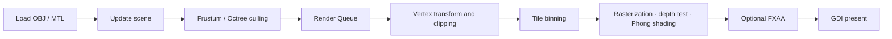

<p align="center">
  <a href="./README.md">한국어</a> ·
  <strong>English</strong> ·
  <a href="./README.ja.md">日本語</a>
</p>

# Software Renderer Project

A Windows software renderer that implements the 3D graphics pipeline directly on the CPU without relying on a GPU rasterizer. Pixels are written to a WinAPI DIB back buffer and presented through GDI. The project focuses on learning rendering fundamentals and applying low-level optimization techniques.

> Development period: 2025-07-07 to 2025-08-27<br>
> Core technologies: C++26 Preview, WinAPI, SSE/AVX, oneTBB, stb_image

## Contents

- [Results](#results)
- [Key features](#key-features)
- [Rendering pipeline](#rendering-pipeline)
- [Build and run](#build-and-run)
- [Controls](#controls)
- [Project structure](#project-structure)
- [Design and optimization](#design-and-optimization)
- [Limitations](#limitations)

## Results

- [Portfolio video with Korean subtitles](https://youtu.be/3StOC1_IjT4)
- [Japanese overview video](https://youtu.be/AWwQuzhvvnM)

### Performance comparison

| Before optimization | After optimization |
| --- | --- |
|  |  |
| 8 FPS | 58 FPS |

These comparison captures were recorded on 2025-08-27. Actual frame rates depend on the CPU, resolution, and build configuration.

### Debug visualization

| Wireframe | AABB | Vertex normals |
| --- | --- | --- |
|  |  |  |

### FXAA

| Before | After |
| --- | --- |
|  |  |

## Key features

| Area | Implementation |
| --- | --- |
| Geometry processing | Model-View-Projection transforms, back-face culling, Sutherland–Hodgman frustum clipping |
| Rasterization | Filled triangles, fixed-point edge functions, Bresenham and DDA line drawing |
| Visibility | Reciprocal-depth buffer, AABB frustum culling, octree-node culling |
| Shading | Directional-light Phong illumination, perspective-correct interpolation, diffuse texture sampling |
| Assets | OBJ/MTL parsers, triangle and quad faces, generated missing normals, PNG loading |
| Parallelism | 16×16 tile binning and oneTBB-based parallel rasterization |
| Post-processing | FXAA |
| Debugging | Wireframe, normal, AABB, and light-direction overlays |
| Math | Custom vector/matrix library, SSE operations, runtime AVX dispatch |
| Platform | WinAPI window, GDI DIB back buffer, resize handling, FPS display |

## Rendering pipeline



Scene objects submit render commands to the queue. Visible triangles are assigned to tile bins, and oneTBB tasks process independent tiles in parallel. Final pixels are written to a 32-bit DIB back buffer and presented with `BitBlt`.

## Build and run

### Requirements

- Windows 10 or Windows 11
- Visual Studio 2026 with MSVC v145
- The **Desktop development with C++** workload and a Windows SDK
- Support for the latest C++ standard and standard-library modules

oneTBB 2023.1.0 and stb_image are vendored under `src/ThirdParty`, so no separate package installation is required.

### Visual Studio

1. Open `SoftrendererProject.sln`.
2. Select a configuration. `Release | x64` is recommended for normal use.
3. Choose **Build > Build Solution**.
4. Choose **Debug > Start Without Debugging**.

The project supports `Debug|x64`, `Release|x64`, `Debug|Win32`, and `Release|Win32`. A post-build step copies the `assets` directory and the architecture-appropriate `tbb12.dll` into the output directory.

### Command line

Run the following in a Visual Studio **Developer PowerShell**:

```powershell
msbuild .\SoftrendererProject.sln /m /p:Configuration=Release /p:Platform=x64
```

## Controls

| Input | Action |
| --- | --- |
| `W` `A` `S` `D` | Move the camera |
| Right mouse button + drag | Rotate the camera |
| `Space` | Toggle automatic model rotation |
| `F1` | Disable anti-aliasing |
| `F2` | Enable FXAA |

The application menu provides additional runtime options:

- Line drawing: Bresenham / DDA
- Anti-aliasing: None / FXAA
- Debug overlays: Normal Vector / AABB / Wire Frame / Light Direction

## Project structure

```text
SoftwareRendererProject/
├─ assets/                 # OBJ, MTL, and texture assets
├─ src/
│  ├─ Core/               # WinAPI application and main loop
│  ├─ Graphics/           # Model, Mesh, Material, Texture, Octree
│  ├─ Math/               # SRMath, AABB, Frustum, SSE/AVX dispatch
│  ├─ Modules/            # sr.math C++ module interface
│  ├─ Platform/           # Minimal Win32 boundary header
│  ├─ Renderer/           # RenderQueue, clipping, tile rasterizer, FXAA
│  ├─ Scene/              # Camera and GameObject
│  ├─ ThirdParty/         # oneTBB and stb_image
│  └─ Utils/              # Error types, fixed-capacity storage, timing
├─ SoftrendererProject.sln
└─ SoftrendererProject.vcxproj
```

## Design and optimization

### Modern C++

| Design | Implementation | Purpose |
| --- | --- | --- |
| Non-owning views | `std::span`, `std::string_view` | Express size and ownership contracts in APIs |
| Structured errors | `std::expected<T, AssetLoadError>` | Decouple parsers from WinAPI UI while preserving file and line context |
| Exception-free number parsing | `std::from_chars` | Avoid temporary strings, locale processing, and exception overhead |
| Fixed-capacity clip buffers | `FixedCapacityVector` with a `std::inplace_vector` path | Remove heap allocation from a small hot path |
| Type constraints | C++20 concepts and the `sr.math` named module | Diagnose invalid types at call sites |
| Resource lifetime | Move-only `Renderer::GdiBackBuffer` | Enforce selected-object restoration and bitmap/DC cleanup ordering through RAII |
| Type-safe storage | `std::array`, ranges, `inline constexpr`, scoped enums | Reduce C arrays and macros |

The project builds with `/std:c++latest`. C++26 library facilities that are not yet available are detected through feature-test macros and replaced by project fallbacks with matching contracts.

### SIMD and multithreading

- A single `vec4` and the matrix operations around it use 128-bit SSE, which matches the data width.
- When two `vec4` values share a transform, runtime checks cover AVX/OSXSAVE CPU bits and the XCR0 XMM/YMM state before selecting the 256-bit AVX path.
- AVX code is isolated in a translation unit compiled with `/arch:AVX`, preserving an SSE path for unsupported CPUs.
- Vertex results, stamps, clip buffers, and triangle pools reuse TBB thread-local storage.
- The frame is divided into 16×16 tiles so binning and rasterization work can be distributed across workers.
- FXAA separates luminance generation from filtering into independent parallel passes to avoid concurrent writes.

### Problems addressed

- Preserved vertex order after clipping and triangulated the result as a triangle fan.
- Generated smooth normals by accumulating face normals when an OBJ contains missing or partial normal data.
- Parsed `v`, `v/vt`, `v//vn`, and `v/vt/vn` face formats through `from_chars`-based code.
- Added a fallback that remaps `usemtl` names containing colons using the suffix after the final colon.
- Encapsulated the required GDI handle and selected-object cleanup order in an RAII type.
- Moved loader error presentation out of the parsers and into the Framework boundary.

## Limitations

- The project targets Windows and the MSVC project system.
- OBJ faces may be triangles or quads; n-gons with five or more vertices are returned as errors.
- Texture sampling currently uses nearest-neighbor filtering and clamp addressing.
- Lighting currently centers on a directional-light Phong model.
- The published FPS values are historical comparisons, not standardized benchmark results.

## Third-party libraries

- [oneTBB 2023.1.0](https://github.com/uxlfoundation/oneTBB): task-based parallelism
- [stb_image](https://github.com/nothings/stb): image decoding
