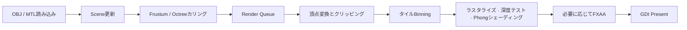

<p align="center">
  <a href="./README.md">한국어</a> ·
  <a href="./README.en.md">English</a> ·
  <strong>日本語</strong>
</p>

# Software Renderer Project

GPUラスタライザーに依存せず、3DグラフィックスパイプラインをCPU上で直接実装したWindows向けソフトウェアレンダラーです。WinAPIのDIBバックバッファへピクセルを書き込み、GDIで画面に表示します。レンダリングの基礎原理と低レベル最適化の学習を目的としています。

> 開発期間：2025-07-07 ～ 2025-08-27<br>
> 主な技術：C++26 Preview、WinAPI、SSE/AVX、oneTBB、stb_image

## 目次

- [映像とスクリーンショット](#映像とスクリーンショット)
- [主な機能](#主な機能)
- [レンダリングパイプライン](#レンダリングパイプライン)
- [ビルドと実行](#ビルドと実行)
- [操作方法](#操作方法)
- [プロジェクト構成](#プロジェクト構成)
- [設計と最適化](#設計と最適化)
- [制限事項](#制限事項)

## 映像とスクリーンショット

- [韓国語字幕付きポートフォリオ映像](https://youtu.be/3StOC1_IjT4)
- [日本語の解説映像](https://youtu.be/AWwQuzhvvnM)

### 性能比較

| 最適化前 | 最適化後 |
| --- | --- |
|  |  |
| 8 FPS | 58 FPS |

上記は2025-08-27に記録した比較結果です。実際のフレームレートはCPU、解像度、ビルド構成によって異なります。

### デバッグ表示

| ワイヤーフレーム | AABB | 法線ベクトル |
| --- | --- | --- |
|  |  |  |

### FXAA

| 適用前 | 適用後 |
| --- | --- |
|  |  |

## 主な機能

| 分野 | 実装内容 |
| --- | --- |
| ジオメトリ処理 | Model-View-Projection変換、バックフェイスカリング、Sutherland–Hodgmanによるフラスタムクリッピング |
| ラスタライズ | 三角形塗りつぶし、固定小数点edge function、Bresenham/DDA線描画 |
| 可視性判定 | 逆数深度バッファ、AABBフラスタムカリング、オクトリーノードカリング |
| シェーディング | 平行光源によるPhong照明、透視補正補間、diffuseテクスチャサンプリング |
| アセット | OBJ/MTLパーサー、三角形・四角形face、欠落法線の自動生成、PNG読み込み |
| 並列処理 | 16×16タイルbinningとoneTBBによる並列ラスタライズ |
| ポストプロセス | FXAA |
| デバッグ | ワイヤーフレーム、法線、AABB、光源方向の可視化 |
| 数学 | 独自ベクトル・行列ライブラリ、SSE演算、実行時AVXディスパッチ |
| プラットフォーム | WinAPIウィンドウ、GDI DIBバックバッファ、リサイズ対応、FPS表示 |

## レンダリングパイプライン



Scene objectから描画コマンドを収集し、画面に影響する三角形をタイルごとのbinへ振り分けます。独立したタイルはoneTBB taskで並列処理され、最終ピクセルは32-bit DIBバックバッファへ書き込まれた後、`BitBlt`で表示されます。

## ビルドと実行

### 必要環境

- Windows 10またはWindows 11
- Visual Studio 2026とMSVC v145
- **Desktop development with C++** ワークロードとWindows SDK
- 最新C++標準および標準ライブラリモジュールのサポート

oneTBB 2023.1.0とstb_imageは`src/ThirdParty`に同梱されているため、別途パッケージをインストールする必要はありません。

### Visual Studio

1. `SoftrendererProject.sln`を開きます。
2. 構成を選択します。通常の実行には`Release | x64`を推奨します。
3. **Build > Build Solution**を実行します。
4. **Debug > Start Without Debugging**で起動します。

対応構成は`Debug|x64`、`Release|x64`、`Debug|Win32`、`Release|Win32`です。ビルド後イベントにより、`assets`ディレクトリと対象アーキテクチャの`tbb12.dll`が出力ディレクトリへ自動的にコピーされます。

### コマンドライン

Visual Studioの**Developer PowerShell**で次のコマンドを実行します。

```powershell
msbuild .\SoftrendererProject.sln /m /p:Configuration=Release /p:Platform=x64
```

## 操作方法

| 入力 | 動作 |
| --- | --- |
| `W` `A` `S` `D` | カメラ移動 |
| マウス右ボタン + ドラッグ | カメラ回転 |
| `Space` | モデルの自動回転を開始／停止 |
| `F1` | アンチエイリアスを無効化 |
| `F2` | FXAAを有効化 |

ウィンドウ上部のメニューから、次の項目も変更できます。

- 線描画：Bresenham / DDA
- アンチエイリアス：None / FXAA
- デバッグ表示：Normal Vector / AABB / Wire Frame / Light Direction

## プロジェクト構成

```text
SoftwareRendererProject/
├─ assets/                 # OBJ、MTL、textureアセット
├─ src/
│  ├─ Core/               # WinAPI applicationとmain loop
│  ├─ Graphics/           # Model、Mesh、Material、Texture、Octree
│  ├─ Math/               # SRMath、AABB、Frustum、SSE/AVXディスパッチ
│  ├─ Modules/            # sr.math C++ module interface
│  ├─ Platform/           # 最小限のWin32境界header
│  ├─ Renderer/           # RenderQueue、clipping、tile rasterizer、FXAA
│  ├─ Scene/              # CameraとGameObject
│  ├─ ThirdParty/         # oneTBBとstb_image
│  └─ Utils/              # error型、固定容量storage、性能計測
├─ SoftrendererProject.sln
└─ SoftrendererProject.vcxproj
```

## 設計と最適化

### Modern C++

| 設計 | 実装 | 目的 |
| --- | --- | --- |
| 非所有view | `std::span`、`std::string_view` | サイズと所有権の契約をAPIで表現 |
| 構造化error | `std::expected<T, AssetLoadError>` | parserとWinAPI UIを分離し、ファイル名と行番号を保持 |
| 例外を使わない数値変換 | `std::from_chars` | 一時文字列、locale、例外のコストを削減 |
| 固定容量clip buffer | `FixedCapacityVector`と`std::inplace_vector`対応経路 | 小さなhot pathでのheap allocationを削減 |
| 型制約 | C++20 conceptsと`sr.math` named module | 不正な型を呼び出し側で診断 |
| リソース寿命 | move-onlyな`Renderer::GdiBackBuffer` | 選択objectの復元とbitmap/DC解放順序をRAIIで保証 |
| 型安全なstorage | `std::array`、ranges、`inline constexpr`、scoped enum | C配列とmacroの使用を削減 |

プロジェクトは`/std:c++latest`でビルドします。まだ利用できないC++26標準ライブラリ機能はfeature-test macroで検出し、同じ契約を持つプロジェクト内fallbackへ切り替えます。

### SIMDとマルチスレッド

- 単一の`vec4`と行列演算には、データ幅に合う128-bit SSEを使用します。
- 同じ行列で2つの`vec4`を変換する場合、AVX/OSXSAVEのCPU bitとXCR0のXMM/YMM stateを確認してから256-bit AVX実装を選択します。
- AVXコードは`/arch:AVX`でコンパイルする別translation unitへ隔離し、非対応CPU向けのSSE経路を維持します。
- 頂点結果、stamp、clip buffer、triangle poolはTBB thread-local storageを再利用します。
- 画面を16×16タイルに分割し、binningとラスタライズの負荷を複数workerへ分散します。
- FXAAはluminance生成とfilter処理を別々の並列passに分け、同時書き込みを避けます。

### 解決した課題

- クリッピング後の多角形で頂点順序を維持し、triangle fanとして再度三角形化しました。
- OBJの法線が欠落、または一部のみ存在する場合、面法線を累積してsmooth normalを生成します。
- `v`、`v/vt`、`v//vn`、`v/vt/vn`形式を`from_chars`ベースで解析します。
- コロンを含む`usemtl`名に対して、最後のコロン以降の名前で再マッピングするfallbackを実装しました。
- GDI handleとDIB選択objectの解放順序をRAII型にまとめました。
- loader内のerror表示を分離し、Framework境界でのみユーザー向けメッセージへ変換します。

## 制限事項

- WindowsおよびMSVC project systemを対象としています。
- OBJ faceは三角形と四角形に対応し、5頂点以上のn-gonはerrorとして返します。
- texture samplingは現在nearest-neighborとclamp addressingを使用します。
- 照明は平行光源を使ったPhongモデルが中心です。
- 公開しているFPSは過去の比較値であり、標準化されたbenchmarkではありません。

## 外部ライブラリ

- [oneTBB 2023.1.0](https://github.com/uxlfoundation/oneTBB)：task-based parallelism
- [stb_image](https://github.com/nothings/stb)：画像デコード
