<div align="center">

<h1>Software Renderer Project</h1>

<p><strong>GPUラスタライザーを使わず、CPU上で直接実装した3Dグラフィックスパイプライン</strong></p>

<p>
  <a href="README.md">🇰🇷 한국어</a> ·
  <a href="README.en.md">🇺🇸 English</a> ·
  <strong>🇯🇵 日本語</strong>
</p>

<p>
  
  
  
  
</p>

<p>
  <a href="https://youtu.be/AWwQuzhvvnM"><strong>▶ 日本語の解説映像を見る</strong></a>
  &nbsp;·&nbsp;
  <a href="https://youtu.be/3StOC1_IjT4">韓国語の解説映像を見る</a>
</p>

</div>

---

DirectX 11を使用する中で抽象的に感じていたレンダリングパイプラインの基礎原理を、自分の手で確かめるために始めたCPUベースのソフトウェアレンダラーです。モデル変換、クリッピング、ラスタライズ、深度テスト、ライティング、後処理、画面出力までを直接実装し、その上にSIMDとタイルベースのマルチスレッド処理を適用しました。

| 開発形態 | 開発期間 | 技術環境 | 画面出力 |
|:---:|:---:|:---:|:---:|
| **個人開発** | 2025.07.07–2025.08.27 | C++26 Preview · MSVC v145 · Windows | WinAPI DIB · GDI |

## Preview

### パフォーマンス比較

| 最適化前 | 最適化後 |
|:---:|:---:|
|  |  |
| **8 FPS** | **58 FPS** |

### デバッグ可視化

| Wireframe | AABB | Normal Vector |
|:---:|:---:|:---:|
|  |  |  |

### FXAA

| 適用前 | 適用後 |
|:---:|:---:|
|  |  |

## 主な成果

| 項目 | 結果 |
|---|---|
| レンダリング経路 | 頂点処理からピクセル出力までを**CPU上で直接実装** |
| 比較画像上の性能 | **8 FPS → 58 FPS** |
| 並列処理単位 | **16×16タイル** + oneTBBタスクスケジューリング |
| SIMD経路 | **128-bit SSE**を基本経路とし、実行時に**256-bit AVX**を選択 |
| 空間高速化 | オブジェクトAABBのfrustum culling + octree node culling |
| デバッグ機能 | Wireframe · Normal · AABB · Light Direction |
| ビルド構成 | Debug/Release × Win32/x64 |

性能画像は2025-08-27時点の比較資料です。CPU、解像度、シーン、ビルド構成によって結果は変わるため、標準化されたベンチマーク値ではありません。

## このプロジェクトで確認できること

### グラフィックスパイプライン

- Model-View-Projection変換とviewport mapping
- Sutherland–Hodgmanによるfrustum plane clipping
- Back-face cullingとreciprocal-depth buffer
- 固定小数点edge functionによるtriangle rasterization
- Perspective-correct attribute interpolation
- Directional lightを用いたPhong illumination
- OBJ/MTL読み込みと別の画像decode API（`map_Kd`自動接続は未対応）
- Bresenham/DDA line drawingとFXAA

### システム設計と最適化

- Render queueと16×16 tile binning
- oneTBBによるcommand処理とtile rasterization
- rendererごとの`WorkerScratch`にまとめたworker別clip buffer・triangle poolと、frame内限定の単一entry頂点・変換行列cache。完全一致するkeyだけ再利用し、詳細は[保守契約](MAINTENANCE.md)を参照
- 独自数学ライブラリ`SRMath`のSSE演算
- CPUID/XCR0確認後にSSE/AVX実装を選択するruntime dispatch
- AABBとoctreeによるcoarse/fine frustum culling
- Move-onlyのGDI back-buffer RAIIと構造化されたasset error
- C++20/23/26機能をAPI契約に反映したmodern C++設計

## レンダリングアーキテクチャ

```mermaid
flowchart LR
    App["WinMain / Framework<br/>Win32 message loop · input · timing"]
    Assets["Asset Pipeline<br/>OBJ · MTL · texture · normal generation"]
    Scene["Scene<br/>Camera · GameObject · transforms"]
    Submit["Scene Submission<br/>AABB / Frustum / Octree · RenderQueue"]
    Frontend["Renderer Front End<br/>MVP · culling · clipping · 16×16 binning"]
    Tiles["Rasterizer / oneTBB Tiles<br/>prepared triangles · depth · Phong"]
    Lines["Line Row Bands<br/>parallel wires / large normal batches · sequential overlays"]
    Post["Post Process<br/>optional FXAA"]
    Target["RenderTarget<br/>borrowed pixels · owned depth / IDs"]
    Present["GdiPresenter<br/>owned 32-bit DIB · BitBlt"]
    Math["Math / SIMD<br/>SRMath · SSE · runtime AVX dispatch"]

    App -->|startup load| Assets
    Assets -->|Model / Mesh| Scene
    App -->|frame update| Scene
    Scene --> Submit --> Frontend --> Tiles --> Lines --> Post --> Present
    App --> Target
    Tiles -. writes .-> Target
    Present -. lends PixelSurfaceView .-> Target
    Math -.-> Assets
    Math -.-> Scene
    Math -.-> Frontend
```



シーンのコマンドはオブジェクト・mesh・octreeの安定した順序で収集します。Clip後の`PreparedTriangle`をworker別の`concurrent_vector` poolに一度作り、`(tileIndex, triangle*)`参照をworker別のflat配列へ記録します。Tile別のcount/cursorとtouched IDを持ち、front-endのjoin後に固定したactive worker一覧からprefix offsetと重ならない出力範囲を計算します。Worker別の並列scatterで単一pointer配列を埋め、join後に各tile spanを任意にsortして描画します。oneTBBとprimitive ID・pixel所有権の規則は維持します。標準の高速X-rayだけのsceneでは、flat tile参照・worker metadataの新規割り当てとdepth prepassを省きます。

Tile別vectorのcapacity累積ではなく、worker別flat参照と最終pointer配列のcapacityを再利用します。`binReferences`は論理参照を一度だけ数え、`retainedBinBytes`はflat/最終/wire/debug保存領域、count/cursor/offset、header、touched/active worker一覧を含みます。`binMs`はfront-end参照準備、`rasterMs`はprefix・scatter・sort・rasterizationの時間です。速度・memoryの比較は進行中であり、性能向上や最終採用を示すものではありません。

`Renderer`はwindow handleを持たず、`RenderTarget&`を受け取ります。`RenderTarget`はstride付きの非所有`PixelSurfaceView`と所有するdepth/ID bufferを接続し、`GdiPresenter`はDIBの生成・resize・表示を担当します。アプリはDIBに直接書き込むため、分離による画面全体の追加コピーはありません。FXAAの既存input snapshotは維持します。

Wireframeの初期値は、隠れた線も表示する高速な**X-ray表示**です。`Hidden-line wireframe (depth prepass)`をONにした場合だけ、wire commandを含むframeで全ての面のdepth-only passを先行し、隠れた線を除きます。標準の混在modeではwire面がfill面を隠さず、prepassもありません。Normalのdepth policyは独立し、存在する面深度を判定します。Hidden wireがOFFならfill面の深度だけを使うため、純粋なX-ray wire sceneにはnormalを隠す面深度がありません。AABB/lightは深度を無視するoverlayで、全ての線pass後に任意でFXAAを適用します。

Wire線はoneTBBの重ならないY行bandで並列処理します。約64行を基準に最大32 bandとし、front-end完了後のtriangle poolとdepth/primitive IDは読み取り専用です。`BeginLineRows`はpixelの書き込み範囲だけを制限し、band境界で端点をclipしたり線を再始動したりしないため、既存のBresenham/DDAのpixel規則を維持します。Wireのjoin後、DepthTested線が256本以上なら256本単位のchunkで変換・clippingを並列準備し、元の提出順を保つbinとY行bandで描画します。少数のnormalは既存の逐次経路を使い、overlayはnormalのjoin後に逐次実行します。

タイル内front-to-back sortingと現フレームのタイル深度を使うHi-Zは独立した実験用メニューで、**両方とも初期値はOFF**です。未記録pixel、同一深度、数値的に不確実な境界は棄却しません。検査・要約更新のコストもあるため、遮蔽が多くても高速化を保証しません。任意のpass時間・counterと比較状況は[可視性変更記録](PERFORMANCE.md#renderer-visibility-2026)を参照してください。

各レイヤーの責務、起動時のアセット読み込み、フレーム実行順序、所有権、並列処理、現在のプラットフォーム境界については、[ARCHITECTURE.md](ARCHITECTURE.md)に韓国語・英語・日本語でまとめています。

## 問題解決事例

この章では結果だけを並べず、開発中に直面した問題、その原因、解決方法、そして得られた結果を一緒に記録します。

| 事例 | 発生した問題 | 解決の要点 |
|---|---|---|
| C++標準とリソース寿命 | 手動初期化・解放とraw handleが失敗経路に弱い | RAII、明示的な変換、`/W4 /WX` |
| SIMD数学演算 | 反復するベクトル・行列演算がCPU rendererのボトルネック | 独自`SRMath`、SSE、限定的なAVX |
| クリッピング | 交差頂点の生成時に順序とwindingの維持が複雑 | Ping-pong clip buffer + triangle fan |
| カメラ近傍のオブジェクト | 投影座標が画面とZ-bufferの範囲を超過 | Call stack分析、clipping、clamp |
| 法線の欠落 | Teapotの一部faceにnormalがなくshadingが破綻 | Face normalを累積してsmooth normalを生成 |
| MTL名 | コロンを含むmaterial keyのlookupに失敗 | 最後のコロン以降を用いるfallback lookup |
| マルチスレッド | 単一スレッドのrasterizationと反復割り当てがボトルネック | Tile rendering、oneTBB、TLS cache/pool |
| 保守性 | 大きな関数と分散した状態で変更の影響を追いにくい | 責務別ファイル、WorkerScratch、回帰テスト |

### 1. C++標準への準拠とリソース寿命

**問題:** 初期の構造では、リソースの寿命が`Init`/`Shutdown`の呼び出し順とraw WinAPI/GDI handleに依存していました。初期化途中の失敗やwindow resizeでは、通常終了とは異なる順序で後処理する必要があり、暗黙的な型変換や外部ライブラリの警告がプロジェクト自身の問題を見えにくくしていました。

**原因分析:** リソースの所有者と解放順序が型ではなく、呼び出し規約とコメントだけで表現されていました。特にDIB bitmapは、削除する前にDCへ選択されていた元のobjectを戻す必要があり、単一のraw pointerだけでは安全な寿命を表現できませんでした。

**解決:** コンストラクターとデストラクターで寿命を管理し、memory DC、DIB bitmap、以前選択されていたobjectをmove-onlyの`sr::platform::GdiBackBuffer`へまとめ、借用したscreen DCは別のscope guardで返却します。型変換は`static_cast`と必要な境界での`reinterpret_cast`によって明示し、プロジェクトコードには`/W4 /WX`、vendor headerにはexternal warning boundaryを適用しました。

**結果:** 中間失敗やresizeでも通常終了と同じRAIIの後処理規則を利用できるようになりました。また、外部コードの警告を除いたプロジェクトソースは、警告をエラーとして扱う設定を通過する状態を維持しています。

### 2. SIMDによる数学演算の最適化

**問題:** ソフトウェアレンダラーでは、行列積、内積、正規化などの数学演算を頂点ごとにCPUで繰り返すため、そのコストがフレーム時間全体へ直接積み上がっていました。

**原因分析:** 3Dベクトルと4×4行列は同じ形式の浮動小数点演算を反復するため、スカラー処理だけではCPUのSIMD実行幅を活用できません。一方、単一の`vec4`を常にAVXへ広げると、256-bit registerの半分が未使用になり、性能向上が保証されませんでした。

**解決:** SSE intrinsicを使用する独自数学ライブラリ`SRMath`を実装し、行列積、内積、正規化などの基本演算を128-bit経路で処理しました。同じ行列で2つの`vec4`を変換するbatchだけを別のAVX translation unitに実装し、CPUIDのAVX/OSXSAVEとXCR0のXMM/YMM保存状態を確認して、実行時にSSEまたはAVX関数を選択しました。

**結果:** 単一ベクトルではデータ幅に合うSSEを維持し、8個のfloatでregisterを埋められるbatchだけにAVXを利用できるようになりました。数学演算のボトルネックは全体最適化の一部として軽減されましたが、公開しているFPS差をSIMDだけの効果とはしていません。

### 3. クリッピング時の頂点順序と三角形の再構成

**問題:** Sutherland–Hodgmanアルゴリズムで三角形を6つのfrustum planeに順番に対して切ると、新しい交差点が生成され、頂点数も変化します。その過程で頂点順序が崩れるとwindingとback-face判定が壊れ、不正な三角形が作られる可能性がありました。

**原因分析:** 各planeの出力polygonが次のplaneの入力になるため、同じbufferで読み書きすると、まだ処理していない頂点を上書きする可能性があります。また、最終結果が常に3頂点とは限らないため、再び三角形へ分割する必要がありました。

**解決:** 入力と出力を交互に切り替えるping-pong clip bufferを使用し、前の頂点と現在の頂点でinside/outside状態が変わる位置に交差頂点を挿入しました。最終polygonの順序を保ったまま、最初の頂点を中心とするtriangle fanへ変換しました。Clip bufferの最大サイズは決まっているため、fixed-capacity storageへ変更しました。

**結果:** Frustum境界を横切るpolygonでもwindingを維持し、安定してrasterizerへ渡せるようになりました。同時に、小さなclipping hot pathで繰り返されていたheap allocationも削除しました。

### 4. 近接オブジェクトでの範囲外アクセス

**問題:** カメラに極端に近いオブジェクトをレンダリングすると、投影後の座標がviewportを大きく外れ、Z-bufferの有効範囲を超えるmemory accessが発生しました。

**原因分析:** Debuggerのcall stackとmemory watchを使い、不正なindexが作られる経路を追跡しました。Near plane付近で大きくなった投影座標が、画面範囲へ制限されないままrasterization bounding boxへ渡り、そのindexがdepth/pixel bufferアクセスに使用されていました。

**解決:** Rasterization前にclip-space frustum testとpolygon clippingを適用しました。NDCとtile範囲は`std::clamp`で画面内へ制限し、最終pixel writeにも境界検査を追加してbuffer外への書き込みを防止しました。

**結果:** カメラ近傍のオブジェクトやviewport境界を横切る三角形でも、有効なpixel座標だけを走査するようになり、テストシーンで発生していた範囲外アクセスを解消しました。

### 5. 欠落した法線ベクトルの補正

**問題:** Utah Teapot OBJの一部polygonにnormal vectorデータが存在せず、その領域のPhong shadingが不均一になったり、誤った明るさで表示されたりしました。

**原因分析:** Positionとindexは正常でしたが、一部のvertexには有効な`vn`がありませんでした。Zero normalのままライティング計算へ入ると、diffuseとspecularの方向を正しく求められません。

**解決:** Mesh内の全vertexが有効なnormalを持つか確認し、1つでも欠落していればtriangleの2本のedgeを外積してface normalを計算しました。その値を3頂点へ累積した後で正規化し、smooth normalを生成しました。縮退したfaceには安全なfallback方向を使用しました。

**結果:** Normal情報が不完全なOBJでも元データを手作業で修正せず、一貫したshadingで表示できるようになりました。

### 6. コロンを含むMTL material名

**問題:** 一部のOBJで`usemtl`名にコロン（`:`）が含まれると、MTLから読み込んだmaterial keyと一致せず、色・光沢属性を取得できない場合がありました。

**原因分析:** OBJ側の名前が`object-part:material`という形式である一方、MTL mapにはコロン以降の実際のmaterial名だけが存在する場合がありました。文字列全体だけをlookupするとfallbackがなく、default materialのままになっていました。

**解決:** まず名前全体でlookupを行い、失敗した場合は最後のコロン位置を探し、その後ろのsubstringでmaterial mapを再検索しました。

**結果:** コロンを含むモデルも意図したmaterialへ再マッピングされ、色・光沢属性を正しく適用できるようになりました。画像decodeは別APIであり、MTLの`map_Kd`自動接続は未対応です。

### 7. タイルベースのマルチスレッド最適化

**問題:** すべての三角形とpixelを1スレッドで処理すると1つのCPU coreしか活用できず、vertex shadingやclippingで使う一時vectorの再割り当てもframe timeを増加させていました。

**原因分析:** Rasterizationでは画面の異なる領域を独立して処理できますが、元の構造には安全に仕事を分割する単位がありませんでした。また、毎frame作られる一時containerはcapacityを繰り返し拡張し、割り当てコストを発生させていました。

**解決:** 画面を16×16 tileに分割し、triangleのscreen-space AABBから影響を受けるtile binへ参照を登録しました。各tileはoneTBB taskとして並列処理し、vertex result、stamp、clip buffer、triangle poolはthread-local storageで再利用しました。`reserve()`、high-watermark cache、ping-pong bufferによって再割り当てを削減しました。

**結果:** 開発中のある測定では、単一スレッド時の約5 FPSからマルチスレッド適用後の約60 FPSまで向上しました。2025-08-27に保存した比較画像では8 FPSから58 FPSへ向上しています。両者は測定時点と条件が異なる開発記録であり、標準化されたベンチマークではありません。

### 8. 動作を維持しながら責務と状態を分離

**問題:** 大きな関数に描画段階と一時状態が混在し、頂点処理・タイル分配・デバッグ出力のどこを変更するべきか、実行の流れを追いにくくなっていました。

**原因分析:** 頂点変換とviewport計算が重複し、workerのキャッシュ・clip buffer・triangle poolが別々に管理されていました。また、画面全体へ書き込む線描画には、タイル内だけへ書き込む塗りつぶしと同じ並列実行規則を適用できません。

**解決:** `RenderScene`を段階ごとの調整関数とし、Frontend・Clipping・Rasterizer・ShadingとプラットフォームのGDI実装を分離しました。一時状態はrendererごとの`WorkerScratch`へまとめました。当時はwireframe/debug lineを塗りつぶし後に逐次化して競合を除き、後続変更でwireと多数のnormalを重ならない行bandに並列化しました。少数のnormalとoverlayは逐次処理します。OBJは文解析・インデックス検証・法線生成・空間構造構築に分け、FrameworkとSceneでも初期化・更新・コマンド収集の責務を区別しました。

**結果:** 関数名と呼び出し順からフレームの流れを読めるようになりました。構造整理と動作上の修正は区別して記録し、回帰テストで検証しています。C++26 Preview、oneTBB、SSE/AVXは維持しており、今回のリファクタリングによる性能向上を測定済みとはしていません。

<details>
<summary><strong>C++26モダナイゼーションの詳細を見る</strong></summary>

### Modern C++の適用

| 従来の方式 | 現在の方式 | 変更理由 |
|---|---|---|
| Raw pointer + 個別の長さ | `std::span`、fixed-extent span | Buffer長と非所有契約を型へ含める |
| C配列と`#define` | `std::array`、`inline constexpr`、scoped enum | サイズと型を保持し、macro汚染を防ぐ |
| `stringstream`、`stoi` | `std::string_view`、`std::from_chars` | 一時文字列・locale・例外コストなしでエラー位置を伝える |
| Loader内部の`MessageBox`/例外 | `std::expected<T, AssetLoadError>` | ParsingとWinAPI UIを分離する |
| Template内部の`static_assert` | C++20 conceptsと`sr.math` module | 不正な型を呼び出し位置で診断する |
| Clipping用`std::vector` | `FixedCapacityVector` / `std::inplace_vector`互換経路 | 固定サイズhot pathのheap allocationを除去する |
| Raw GDI handleの手動解放 | Move-onlyの`sr::platform::GdiBackBuffer` | 選択objectの復元 → bitmap削除 → DC削除の順序を保証する |
| 単一SSE経路 | CPUID/XCR0 runtime dispatch + 別AVX translation unit | 古いCPU向け経路を保ち、適切なbatchだけにAVXを使う |
| 重複するFXAA parallel write | `span` API + luminance/filter passの分離 | 同じ値を書き込む場合でも発生するdata raceを除去する |

プロジェクトは`/std:c++latest`を使用します。まだ提供されていないC++26 library機能はfeature-test macroで確認し、現在の値型に必要な操作を提供するfallbackを使用します。固定容量fallbackの`clear()`は論理サイズだけを初期化するため、`std::inplace_vector`と異なり要素を直ちに破棄しません。新しいという理由だけで機能を採用するのではなく、単一の`vec4`のようにSSEの幅が自然に一致する演算は意図的にその実装を維持しています。

</details>

## 保守とテスト

### コードを読む順序

| 関心事 | 主なコードと役割 |
|---|---|
| フレーム調整 | `Framework::runFrame` → `GameObject::Update/SubmitToRenderQueue` → `Renderer::RenderScene` |
| 描画段階 | `prepareFrame` → `binCommands` → `renderTiles` → `renderLines` → `applyPostProcessing` |
| レンダラー実装 | `RendererFrontend.cpp`、`RendererClipping.cpp`、`Rasterizer.cpp`、`RendererShading.cpp` |
| 状態と寿命 | rendererごとの`WorkerScratch`、非所有`RenderQueue`、`RenderTarget`のdepth/ID、`GdiPresenter`のDIB |
| アセット解析 | `ModelLoader.cpp`、`TextureLoader.cpp`、トークン・数値解析を共有する`AssetParsing.h` |
| 数学 | `SRMath.h`をincludeの入口として残し、FixedPoint・Vector・Matrixヘッダーに実装を分離 |
| ビルドと規則 | アプリ・テスト共通の`build/*.props`と自作コード用の`.clang-format`。ThirdPartyは整形対象外 |

設計意図・座標系・所有権・並列実行条件は韓国語のコードコメントで説明しています。詳細な契約とコードの場所は[保守ガイド](MAINTENANCE.md#日本語)を参照してください。

### 動作修正と回帰検査

| 項目 | 修正と検証 |
|---|---|
| クリッピング | 同次座標で線形補間し、透視補正はラスタライズ時だけに実施。棄却時の出力初期化、6平面・固定容量・入力不変性を検査 |
| Win32 Releaseの補間 | 複合vector式の一時値経路で入力破損を再現。同じ減算 → 乗算 → 加算の順序を明示的なSSEで表現し、許容誤差は維持 |
| 線描画 | 初期逐次化でtile間競合を解消。現在wireと多数のnormalは順序を保つY行band、少数のnormal/overlayは逐次。pixel/depth/ID/stats/paddingとband境界を比較 |
| Scene・入力 | 親変換、可視な子、重複・循環接続の拒否、Spaceのキーリピート、アルゴリズムメニュー状態 |
| バッファ・後処理 | renderer間の独立性、フレーム初期化、0×0 resizeと復帰、Phong、FXAA |

### テストの実行と確認結果

`RendererTests`は外部テストフレームワーク不要で、Releaseでも失敗時に非ゼロ終了コードを返します。リポジトリルートのPowerShellから実行します。

```powershell
# アプリとテストを4構成すべてで再ビルドして実行
./tests/RunTests.ps1 -Rebuild

# 選択した構成だけをビルドして実行
./tests/RunTests.ps1 -Platforms x64 -Configurations Debug

# x64 Releaseだけをビルドし一部のテストを実行(失敗と要約だけを表示)
./tests/RunTests.ps1 -Quick -Filter golden

# headless srcliでモード別のフレーム時間を測定(目標100fps、JSON Linesで保存)
./tests/Bench.ps1
```

windowなしで同じデモシーンを描画する`srcli`(`tools/srcli`)と、`tests/golden/*.png`と比較するgolden imageテストがあります。`srcli render --out frame.png`でフレームをPNG保存でき、`CMakeLists.txt`でLinuxなどでもcore・srcli・テストをビルドできます(`tools/dev.sh`)。AI作業向けの要約は[CLAUDE.md](CLAUDE.md)です。

Benchmarkは60フレーム準備後に指定フレーム数を測定します。`none | sort | hiz | both`を比較し、`stats`は診断時だけ使います。標準`wire`はX-rayで、末尾の`hidden`が隠線を選択します。計測なしなら直前の診断位置に`nostats`を明記します。合成シーンは`occluded | open`で表示コストを含みません。条件は[保守ガイド](MAINTENANCE.md)を参照してください。

```powershell
.\tests\bin\x64\Release\RendererTests.exe . --benchmark 600 1280 720 fill none
.\tests\bin\x64\Release\RendererTests.exe . --benchmark 600 1280 720 normal both stats
.\tests\bin\x64\Release\RendererTests.exe . --benchmark 600 1280 720 wire none nostats hidden
.\tests\bin\x64\Release\RendererTests.exe . --visibility-benchmark 600 1280 720 fill both occluded
.\tests\bin\x64\Release\RendererTests.exe . --visibility-benchmark 600 1920 1080 fill none open
.\tests\bin\x64\Release\RendererTests.exe . --visibility-benchmark 120 1280 720 wire none occluded nostats hidden
```

次の表は可視性変更前のリファクタリングに対する2026-10-05の検証記録です。今回のbuffer分離・隠線・sorting・Hi-Zの検証完了を示すものではありません。新しい検証状況は[可視性変更記録](PERFORMANCE.md#renderer-visibility-2026)に分けて記録し、ログはGit対象外の`tests/bin/logs`に保存します。

| 構成 | アプリ・テスト再ビルド | ランタイムテスト | 警告 |
|---|---|---|---|
| Debug × x64 | 成功 | 成功 | 0 |
| Release × x64 | 成功 | 成功 | 0 |
| Debug × Win32 | 成功 | 成功 | 0 |
| Release × Win32 | 成功 | 成功 | 0 |

行列・法線変換、AABB/Frustum、viewport、正常・異常アセット、SIMDの数値比較も検査します。IronManとteapotは非表示のWin32ウィンドウのGDIバッファで、回転・デバッグモード・FXAAを実行しました。アプリとテストのアセット配置、アーキテクチャ別oneTBB DLLのハッシュも確認しています。

**検証範囲:** このテストはheadlessランタイムではなく、手動の目視回帰を置き換えるものでもありません。実際のカメラ・マウス・最小化操作、変更前後の画面比較、AVX非対応実機での検証は未実施です。既存の8 → 58 FPS画像は今回のリファクタリングの測定結果ではありません。

**以前の性能記録:** VS CPU UsageとVTuneでタイル重複登録・線描画コストを確認した以前の最適化では、Release x64・1280×720・非表示GDIウィンドウの3回比較で塗り・法線・wireframe時間が約39.5%・26.8%・30.5%減少しました。これは今回のhidden-wire option・sorting・Hi-Zの結果ではありません。新しい比較ではX-ray/hidden-wire設定とnormalのdepth policyを区別します。[当時の条件](PERFORMANCE.md#日本語)と[可視性変更記録](PERFORMANCE.md#renderer-visibility-2026)を参照してください。

新しい回帰テストはmemory targetのstride/padding、不正・0サイズ、depth/ID、FXAA、遮蔽、同一深度、単一/複数workerのpixel/depth比較を扱います。Memory描画テストと`srcli`はwindowなしで実行できます。FXAAの既存red/blue輝度重みの不一致は構造変更と分けて維持し、回帰テストで固定します。

**ツールチェーンの制限:** ソース分割後、MSVC 14.51.36231の`/GL`リンク中にC1001内部コンパイラーエラーが発生したため、ReleaseのLTCGだけを無効化しました。通常の最適化とSSE/AVXは維持しています。ツールチェーン更新後にテストと性能測定を行ってから再有効化できます。

## ビルドと実行

### 必要環境

- Windows 10またはWindows 11
- Visual Studio 2026とMSVC v145
- `Desktop development with C++` workloadとWindows SDK
- 最新C++標準と標準ライブラリmoduleのサポート

oneTBB 2023.1.0とstb_imageは`src/ThirdParty`に含まれているため、別途packageをインストールする必要はありません。

### Visual Studio

1. Repository rootの`SoftrendererProject.sln`を開きます。
2. `Release | x64`、または必要な構成を選択します。
3. **Build > Build Solution**を実行します。
4. `SoftrendererProject`をスタートアッププロジェクトに設定し、**Debug > Start Without Debugging**で起動します。`RendererTests`は別のコンソールテスト実行ファイルです。

対応構成は`Debug|x64`、`Release|x64`、`Debug|Win32`、`Release|Win32`です。ビルド後、`assets`と対象architectureの`tbb12_debug.dll`（Debug）または`tbb12.dll`（Release）がoutput directoryへ自動的にコピーされます。

### コマンドライン

Visual Studioの**Developer PowerShell**で実行します。

```powershell
msbuild .\SoftrendererProject.sln /m /p:Configuration=Release /p:Platform=x64
```

### 操作

| 入力 | 動作 |
|---|---|
| `W` / `A` / `S` / `D` | カメラ移動 |
| マウス右ボタン + drag | カメラ回転 |
| `Space` | モデルの自動回転を開始・停止 |
| `F1` | Anti-aliasingを無効化 |
| `F2` | FXAAを有効化 |

Window上部のmenuから、Bresenham/DDA line drawing、None/FXAA、Normal Vector/AABB/Wire Frame/Light Direction表示も選択できます。

Algorithmsには独立した`Front-to-back sorting (experimental)`、`Hi-Z culling (experimental)`、`Hidden-line wireframe (depth prepass)`があり、全て初期値OFFです。DebugのWire Frameは標準ではX-ray表示で、hidden wireを追加でONにすると面depth prepassと隠線除去を使います。Normalは別のdepth policyを維持し、AABB/light directionはoverlayです。

<details>
<summary><strong>ディレクトリ構成を見る</strong></summary>

### ディレクトリ構成

```text
SoftwareRendererProject/
├─ assets/                 # OBJ、MTL、texture assets
├─ build/                  # 共通MSBuild設定とruntime source一覧
├─ tests/                  # 回帰テスト、golden image、fixture、実行script
├─ tools/srcli/            # headless benchmark・PNG dump CLI
├─ src/
│  ├─ Core/               # WinAPI Framework、デモシーン、headless runner
│  ├─ Graphics/           # Model、Mesh、Material、Texture、Octree
│  ├─ Math/               # SRMath、AABB、Frustum、SSE/AVX dispatch
│  ├─ Modules/            # sr.math C++ module interface
│  ├─ Platform/           # Win32 boundary headerとGDI back buffer RAII
│  ├─ Renderer/           # RenderQueue、clipping、tile rasterizer、FXAA
│  ├─ Scene/              # CameraとGameObject
│  ├─ ThirdParty/         # oneTBBとstb_image
│  └─ Utils/              # Error type、fixed-capacity storage、timing
├─ ARCHITECTURE.md
├─ CLAUDE.md              # AI作業向け要約(コマンド、規則、性能基準)
├─ CMakeLists.txt         # headlessビルド(core、srcli、テスト)
├─ MAINTENANCE.md
├─ PERFORMANCE.md
├─ RendererTests.vcxproj
├─ SrCli.vcxproj
├─ SoftrendererProject.sln
└─ SoftrendererProject.vcxproj
```

</details>

## 設計範囲と制限事項

- WindowsとMSVC project systemを対象としています。
- OBJ faceはtriangleとquadに対応し、5頂点以上のn-gonは明示的なerrorとして返します。
- Texture samplingは現在nearest-neighbor filteringとclamp addressingを使用します。
- Lightingはdirectional lightベースのPhong modelを中心に実装しています。
- 公開しているFPS値は異なる開発段階の記録であり、同一条件で測定した正式なbenchmarkではありません。
- CPU rendering pipelineの学習と最適化に焦点を当てており、GPU API backendや汎用scene editorは対象外です。
- `sr.math`はmoduleの部分導入です。コード全体をnamed moduleや`import std;`へ移行した状態ではありません。
- Renderer coreとheadlessツール(`srcli`、テスト)はCMakeでGCCでもビルドできますが、windowアプリとFramework/GDIテストはWindows/MSVC専用です。新しいJob Systemは追加していません。
- MTLは色・光沢を解析しますが、`map_Kd`は自動接続しません。画像decodeは別の`LoadImageFile` APIです。

## 外部ライブラリ

- [oneTBB 2023.1.0](https://github.com/uxlfoundation/oneTBB): task-based parallelism
- [stb_image](https://github.com/nothings/stb): image decoding
