<div align="center">

<h1>Software Renderer Project</h1>

<p><strong>GPU 래스터라이저 없이 CPU에서 직접 구현한 3D 그래픽스 파이프라인</strong></p>

<p>
  <strong>🇰🇷 한국어</strong> ·
  <a href="README.en.md">🇺🇸 English</a> ·
  <a href="README.ja.md">🇯🇵 日本語</a>
</p>

<p>
  
  
  
  
</p>

<p>
  <a href="https://youtu.be/3StOC1_IjT4"><strong>▶ 한국어 영상 보기</strong></a>
  &nbsp;·&nbsp;
  <a href="https://youtu.be/AWwQuzhvvnM">日本語の解説映像</a>
</p>

</div>

---

DirectX 11을 사용하며 부족하다고 느꼈던 렌더링 파이프라인의 기본 원리를 직접 확인하기 위해 시작한 CPU 기반 소프트웨어 렌더러입니다. 모델 변환부터 클리핑, 래스터화, 깊이 테스트, 조명, 후처리와 화면 출력까지 직접 구현하고, 그 위에 SIMD와 타일 기반 멀티스레딩을 적용했습니다.

| 개발 형태 | 개발 기간 | 기술 환경 | 화면 출력 |
|:---:|:---:|:---:|:---:|
| **1인 개인 프로젝트** | 2025.07.07–2025.08.27 | C++26 Preview · MSVC v145 · Windows | WinAPI DIB · GDI |
| **AI 기반 코딩 (Claude · Gemini 3.8/Argon)** | 2026.10.20– | C++26 Preview · MSVC v145 · Windows / GCC (CI) | WinAPI DIB · GDI |

2026.10.20부터는 AI(Claude, Gemini 3.8/Argon)가 코드를 작성하고 최적화합니다. 변경은 측정된 fps/ms와 어셈블리 검토로 판단하고, 테스트·골든 이미지·CI로 검증합니다.

## AI 작업 성과 요약 (2026.10.20–10.22)

**결론: 목표인 1920×1080 100fps를 세 모드 모두 넘었습니다.** PC(MSVC Release x64, 24스레드)에서 느린 프레임 기준(p95)으로 fill 3.39ms, wire 4.15ms, normal 6.05ms이며, 기준선 p95 ≤ 9ms 안에 들어옵니다. 1080p를 처음 잰 2026-10-21과 비교하면 평균 프레임 시간이 54~56% 줄었습니다.

| 모드 | 처음 (2026-10-21) mean / p95 | 지금 (main 8df4d1b) mean / p95 | 평균 시간 변화 | 평균 fps |
|---|---|---|---|---|
| fill | 6.66 / 7.90 ms | 2.95 / 3.39 ms | **−55.8%** | 150 → **339** |
| wire | 7.27 / 8.56 ms | 3.33 / 4.15 ms | **−54.2%** | 138 → **300** |
| normal | 11.27 / 12.69 ms (기준 미달) | 5.14 / 6.05 ms | **−54.4%** | 89 → **195** |

> 처음 값은 PR #6 직전 `RendererTests --benchmark`(600프레임, 6회 중앙값), 지금 값은 #31까지 머지된 main(8df4d1b)을 #27 직후 main(c152e76)과 번갈아 잰 PC A/B(`srcli bench`)입니다. 이 측정에서 #28~#32의 합계는 fill −11.2%, wire −2.6%(구분 불가), normal −15.2%였습니다. 측정한 날과 도구가 달라서 누적 변화는 근사치입니다. 정확한 근거는 아래 표의 PR별 A/B입니다. 모든 변경에서 픽셀 해시가 변경 전과 같았습니다(화면 변화 없음).

### 1. 성능 최적화 (채택한 것)

PR마다 같은 PC에서 변경 전(base)과 후(head)를 번갈아 재고, 통계적으로 유의하게 줄었을 때 채택했습니다(초기 2% 이상, ~3ms 구간에서는 평균 1% 이상 기준). 수치는 평균 프레임 시간 변화입니다(n.s. = 유의하지 않음).

| PR | 무엇을 바꿨나 | fill | wire | normal |
|---|---|---:|---:|---:|
| #2 | 법선 선 프레임에서 메인 스레드 직렬 작업 제거 (1280×720 측정) | −14.4% | −13.8% | −20.5% |
| #6 | 선 band를 선 개수 기준으로 균형, 스페큘러 0이면 `powf` 생략 | −2.7% | −24.1% | −17.3% |
| #17 | 화면 전체 지우기 단계를 없애고 타일 작업 안에서 지우기 | −3.1% | 변화 없음 | −4.1% |
| #20 | Octree를 평탄화하고 보이는 삼각형을 연속 범위로 묶음 (명령 11,579 → 1,055개/프레임) | **−16.9%** | **−23.5%** | **−10.5%** |
| #21 | 4096칸 정점 캐시(L2 안), 삼각형 제자리 준비, 정점 prefetch, SSE 색 변환 | −7.0% | −4.0% | −2.4% |
| #23 | 타일 작업을 4타일 단위로 나누고, 직렬 전역 prefix를 worker별 정렬로 바꿈 | **−10.5%** | 변화 없음 | −6.9% |
| #24 | 깊이 판정을 먼저 끝내고 픽셀마다 셰이딩 한 번 (셰이딩 픽셀 312,670 → 181,480) | −6.2% | 변화 없음 | −4.0% |
| #26 | 픽셀 4개를 SSE 레인에 묶어 셰이딩 (비트 단위 동일 결과) | −4.0% | n.s. | −2.8% (n.s.) |
| #27 | 16×16 타일 버퍼에 그리고, 화면 크기 삼각형 ID 면 제거 (픽셀당 16 → 8바이트) | **−13.3%** | **−8.7%** | **−6.8%** |
| #28 | oneTBB를 자체 Job System(`sr::jobs`)으로 교체하고 외부 라이브러리 제거 | 같음 (n.s.) | 같음 (n.s.) | 같음 (n.s.) |
| #30 | 타일 정렬·법선 선 준비를 분류 작업 안으로 옮기고, 법선 band를 타일 행이 끝나는 대로 그림 (join 제거) | −3.4% | 변화 없음 | **−8.4%** |
| #32 | 하이브리드 CPU 대응: E코어에서는 대기 spin을 짧게, 작업 스레드의 Windows 전력 조절(EcoQoS) 해제 | n.s. | n.s. | −6.3% |
| #31 | 타일 작업을 지난 프레임의 비용 기준으로 스레드마다 나눔 (화면 순서 유지) | −2.9% | 변화 없음 | −2.3% |
| #46 | 그림자 맵 래스터화 단일 잡 디스패치 및 원자적 깊이 갱신(`atomicMinDepth`) 병렬화 (단일 패스 섀도우 45.98 ms → 7.55 ms) | **−83.6%** | **6.1배 가속** | 132.5 FPS 달성 |
| #47 | 3분할 캐스케이드 섀도우 맵(CSM) 및 16-Tap Poisson Disk 부드러운 그림자 (외접구 피팅·텍셀 스냅·15% 경계 블렌딩·직교 나눗셈 생략) | **+2.29 ms** | 100+ FPS 유지 | **9.84 ms (101.6 FPS)** |
| #49 | 고부하 30 FPS 스트레스 벤치마크 씬 (1.88M 삼각형, 2,660개 서브메시, 22개 오브젝트) 및 인메모리 모델 복제 캐싱 (`CloneMesh`, 로드 시간 6.0초 → 0.28초) | **30 FPS 기준선 구축** | wire 46.75 ms | normal 51.58 ms |
| #50 | 계층적 타일 비닝 단일 타일 비트마스크 패스트패스 & 4-Lane SIMD 코너 반평면 탈락 + SIMD 4픽셀 병렬 에지 순회 및 벡터화 셋업 (1.88M 삼각형 씬) | **−3.3% (33.1 FPS)** | **−4.6% (22.4 FPS)** | **−6.7% (20.8 FPS)** |

각 PR의 커밋 메시지에 VTune·VS CPU Usage 핫스팟 전후, MSVC 어셈블리(/FAs) 전후, 테스트 결과가 있습니다.

### 2. 시도했지만 채택하지 않은 것

측정에서 2% 이상 빨라지지 않았거나 오히려 느려진 변경은 버리고 이유를 기록했습니다.

| 시도 | 결과 | 배운 점 |
|---|---|---|
| 분류(binning) 단계 SIMD·지연 셰이딩 | VTune 분류 CPU −4~−17%, 그러나 PC 프레임 시간 fill −1.0%, wire −1.8%, normal −1.1% | 24스레드에서는 한 단계의 CPU 절감이 프레임 시간에 거의 반영되지 않음 |
| 삼각형 래스터 루프(SSE 커버리지 마스크, 분기 없는 Bresenham) | VTune 래스터 CPU −18%, 그러나 프레임 시간 −0.5~−1.7%. 분기 없는 Bresenham은 MSVC에서 더 느림 | 위와 같음 |
| 정점 준비 결과를 메시 크기 배열로 캐시 | 명령 수(Ir)는 줄었지만 PC fill +6.4% 느려짐(worker당 23MB) | 명령 수보다 메모리 크기가 중요. worker별 배열은 L2에 맞게 |
| 타일 되쓰기를 streaming store로 | 클라우드 fill +9.6% 느려짐 | |
| ClearRect·타일 버퍼 복사를 SSE 저장으로 | 차이 없음(모두 n.s.) | 비용은 호출이 아니라 차가운 메모리 쓰기 |
| wire band를 8/4행으로 | +6% / +9% 느려짐 | 한 선을 여러 band가 중복으로 걷게 됨 |
| LTCG | 2~4% 빨랐지만 전체 빌드 27초 → 113초 | |
| 비싼 타일 묶음부터 나눠 주기 (LPT) | PC fill +7.0% 느려짐 | 이웃 타일이 다른 코어로 흩어져 캐시를 잃음 |
| 작업 스레드를 코어에 고정 (P코어 먼저) | PC fill +7.0%, wire +20.4%, normal +10.4% 느려짐 | 고정하면 Windows가 바쁜 스레드를 P코어로 옮기지 못함 |
| 대기 중 300us spin + 5ms yield | fill +19.9%, wire +53.0% 느려짐 | yield가 가장 큰 핫스팟이 됨 |
| SoA 정점 일괄 변환 (공격 벡터 1) | 2,660개 분산 서브메시 환경에서 사전 SoA 배치 할당 및 미참조 정점 변환이 L1/L2 캐시를 오염시켜 프레임 시간 오히려 증가 (fill 30.17ms 대비 39.3ms로 +30.3% 느려짐) | 2,660개 메시의 잦은 드로우콜 구조에서는 사전 배치 변환보다 L2 내부 4096칸 지연 정점 캐시(`cachedVertex`)가 훨씬 우수함 |

### 3. AI가 일하기 위한 도구와 문서

| 항목 | 역할 |
|---|---|
| [AGENTS.md](AGENTS.md) | AI 공통 규칙: 100fps 기준(p95 ≤ 9ms), 명령, 작업 순서, 판정 규칙. Claude Code와 Gemini CLI(Gemini 3.8/Argon)가 공통으로 따르는 작업 명세 |
| 어셈블리 기준 최적화 규칙 (CLAUDE.md, PR #19) | 소스 추측이 아니라 생성된 어셈블리(`/FAs`, `dumpbin /disasm`)를 보고 최적화하고, 전후를 기록. 매 프레임 코드와 로딩 코드에 적용 |
| 프로파일링 필수 규칙 (CLAUDE.md, PR #22) | 모든 최적화는 PC에서 VTune과 VS CPU Usage 둘 다로 전후 측정하고 핫스팟 점유율을 기록 |
| [CODEMAP.md](CODEMAP.md) | 소스 파일마다 역할 한 줄. CI(`tools/ci/check_codemap.py`)가 빠진 파일을 잡음 |
| `srcli` (`tools/srcli`) | 창 없이 데모 장면을 그림. `bench --json`(프레임 시간, `pixel_hash`), `render --out`(PNG), `--scene`(glTF + 애니메이션) |
| 테스트 | 외부 프레임워크 없는 `RendererTests` (PC MSVC 118개 전 통과), 골든 이미지 8장(`tests/golden`) |
| 스크립트 | `tests/RunTests.ps1 -Quick/-Filter/-UpdateGolden`, `tests/Bench.ps1`(JSON Lines), `tests/CaptureCpuProfiles.ps1`(VTune + VS CPU Usage), `tools/dev.sh`(Linux), `tools/Worktree.ps1` |

### 4. 자동화

| 항목 | 내용 |
|---|---|
| GitHub CI (`ci.yml`, `windows.yml`) | Linux GCC 빌드·단위·골든 테스트, ASan+UBSan, CODEMAP 검사. GitHub 호스트 Windows에서 MSVC 빌드·테스트와 `/analyze /WX`. MSVC ASan은 main push와 수동 실행에만. 문서만 바뀐 PR은 Windows를 건너뜀. PR 대기 약 23분 → 약 10분 |
| 클라우드 A/B 벤치 (`ab-bench.yml`) | 같은 VM에서 base·head를 번갈아 측정. `/Brepro`로 같은 소스면 같은 바이너리(바이너리 동일이면 측정 생략). A/A 실험(`ab-calibrate.yml`)으로 판정 규칙 검증: 유의하고 1% 이상일 때만 변화로 봄(초기 2%). 결론이 나면 조기 종료(23분 → 약 10분). PR에 `ab-bench` 라벨을 붙이면 실행 |
| PC Job Runner (PC 로컬) | 클라우드 작업이 PC 큐 폴더에 작업을 넣으면 PC가 순서대로 자동 실행(빌드, 테스트, 벤치, 프로파일, push, PR). 상태 창과 트레이에 단계·남은 시간·대기열 표시 |
| SRJob.ps1 표준 (PC 로컬) | SHA별 빌드 캐시, 적응형 A/B(결론 나면 6~12라운드에서 종료), 기준 프로파일 캐시. 측정 작업 약 22분 → 약 8~10분 |
| Worktree | 작업마다 `..\SR-worktrees\<브랜치>`에서 따로 작업해 PC 원본 트리를 건드리지 않음 |

### 5. 추가한 기능 (로드맵 1~17단계)

| 단계 | PR | 내용 |
|---|---|---|
| 1 | #11 | 자체 JSON 파서, 백그라운드 파일 로드, `.obj` 드래그 앤 드롭·모델 열기 |
| 2 | #14 | 프로젝트 폴더와 씬 파일(`.srproj`, `.srscene`), 파일 메뉴, 저장·다시 열기 |
| 3 | #13 | 자체 PNG/JPEG/BMP/TGA/DDS 디코더(BC1–BC5, BC7 포함). stb_image와 84개 파일에서 같은 결과를 확인한 뒤 stb_image 제거 |
| 4 | #15 | 외부 라이브러리 없는 glTF 2.0 로더(`.gltf`/`.glb`, 계층, 재질, skin·animation 데이터) |
| 5 | #16 | 애니메이션: 쿼터니언, glTF 키프레임 재생, CPU 스켈레탈 스키닝(SSE/AVX, 같은 결과) |
| 6 | #35 | 에디터 인터랙션: 씬 픽킹(Scene Picking), 트랜스폼 기즈모(Gizmo), Undo/Redo, glTF/쿼터니언 영속화 |
| 7 | #36 | 렌더 품질 고도화: Bilinear/Mipmap 텍스처 필터링, Point/Spot 라이트, 노멀 매핑(Normal Mapping), sRGB 감마 보정 |
| 8 | #39 | 실시간 섀도우 매핑: Directional & Spot Light Shadow Mapping, SSE 4-lane 2x2 PCF Soft Shadows |
| 9 | #41 | 반투명 렌더링: Alpha Mask Cutout 및 Back-to-Front Alpha Blending 깊이 정렬 파이프라인 |
| 10 | #42 | 물리 기반 렌더링(PBR): glTF 2.0 Metallic-Roughness PBR, Cook-Torrance BRDF (GGX D, Schlick-GGX G, Schlick F) |
| 11 | #43 | 이미지 기반 조명(IBL) 및 톤매핑: IBL 환경맵 반사/확산, ACES Filmic Tone Mapping |
| 12 | #44, #45 | 교체형 셰이딩 파이프라인 & AVX2 8-Lane SIMD: Swappable Shading Pipeline, AVX2 8-lane SIMD 셰이딩, 5개 절차적 벤치마크 씬 |
| 13 | #45 | Cloud Baker Engine: CPU 텍스처 베이킹 엔진 (UV 래스터라이저, Dilation 필터, Normal 베이킹, AO 앰비언트 오클루전) |
| 14 | #46 | 섀도우 맵 래스터화 병렬 최적화: 단일 잡 디스패치 및 lock-free atomicMinDepth (45.98ms → 7.55ms, 6.1배 가속) |
| 15 | #47 | 3분할 캐스케이드 섀도우 맵(CSM) 및 16-Tap Poisson Disk 부드러운 그림자: 외접구 피팅, 텍셀 스냅, 15% 경계 블렌딩, 직교 나눗셈 생략으로 100+ FPS 유지 |
| 16 | #49 | 1.88M 삼각형 30 FPS 고부하 스트레스 벤치마크: IronMan 편대 12기 + Teapot 10기(총 22개 오브젝트, 2,660개 서브메시, 1,878,204개 삼각형), 인메모리 모델 복제 캐싱(`CloneMesh` 6.0초 → 0.28초) |
| 17 | #50 | 33+ FPS 극한 최적화: 계층적 타일 비닝 단일 타일 비트마스크 패스트패스, SIMD 4-Lane 코너 반평면 탈락(프레임당 6,963개 거짓 참조 제거), 4픽셀 SIMD 병렬 에지 순회, 16바이트 스택 프레임 벡터화 셋업 |

그 밖에 Framework를 Scene·FrameRunner·Win32App·SceneRenderCollector로 나눴고(#9), `vec2`/`vec3`의 `==`가 같은 벡터를 다르다고 판단하던 버그를 고쳤습니다(#12). 병렬 처리는 oneTBB 대신 자체 Job System(`sr::jobs`, #28)이 맡습니다.

## Preview

### 성능 비교

| 최적화 전 | 최적화 후 |
|:---:|:---:|
|  |  |
| **8 FPS** | **58 FPS** |

### 디버그 시각화

| Wireframe | AABB | Normal Vector |
|:---:|:---:|:---:|
|  |  |  |

### FXAA

| 적용 전 | 적용 후 |
|:---:|:---:|
|  |  |

## 핵심 성과

| 항목 | 결과 |
|---|---|
| 렌더링 경로 | 정점 처리부터 픽셀 출력까지 **CPU에서 직접 구현** |
| 셰이딩 모델 | Phong · Cook-Torrance PBR (glTF 2.0 Metallic-Roughness) · IBL · ACES Tone Mapping |
| 그림자 파이프라인 | **3분할 캐스케이드 섀도우 맵(CSM)** + **16-Tap Rotated Poisson Disk PCF 부드러운 그림자** (1080p 100+ FPS) |
| 성능 비교 이미지 | **8 FPS → 58 FPS** (2025 베이스라인) → **100+ FPS** (CSM 섀도우 포함 Full HD) → **33+ FPS** (1.88M 폴리곤 30 FPS 스트레스 벤치마크) |
| 병렬 처리 단위 | **16×16 tile** + 자체 Job System(`sr::jobs`) 작업 분배 |
| SIMD 경로 | **128-bit SSE** 기본 경로 + 런타임 **256-bit AVX/AVX2** (8-lane SIMD 셰이딩) |
| 베이킹 엔진 | CPU 텍스처 베이커: UV 래스터라이저, Dilation, 법선/AO 맵 베이킹(`sr::baker`) |
| 공간 가속 | Object AABB frustum culling + octree node culling |
| 외부 의존성 | **외부 라이브러리 0개 (Zero External Dependencies)** (stb_image, oneTBB 완전 제거) |
| 단위/회귀 테스트 | **118개 전 테스트 통과** (`SUMMARY passed=118 failed=0`) |
| 디버그 도구 | Wireframe · Normal · AABB · Light Direction · Transform Gizmo |
| 빌드 구성 | Debug/Release × Win32/x64 |

성능 이미지는 2025-08-27 당시의 비교 자료입니다. CPU, 해상도, 장면과 빌드 구성에 따라 결과가 달라지므로 표준화된 벤치마크 수치로 보지는 않습니다.

## 무엇을 보여주는 프로젝트인가

### 그래픽스 파이프라인

- Model-View-Projection 변환과 viewport mapping
- Sutherland–Hodgman frustum plane clipping
- Back-face culling과 reciprocal-depth buffer
- 고정소수점 edge function 기반 triangle rasterization
- 원근 보정 attribute interpolation
- Directional light 기반 Phong illumination
- OBJ/MTL 로딩과 MTL `map_Kd` 텍스처 자동 연결, 자체 이미지 디코더(PNG, JPEG, BMP, TGA, DDS)
- Bresenham/DDA line drawing과 FXAA

### 시스템·최적화

- Render queue와 16×16 tile binning
- 자체 Job System(`sr::jobs`) 기반 command 처리와 tile rasterization
- renderer별 `WorkerScratch`에 모은 worker별 clip buffer·triangle pool과 프레임 한정 단일 키 정점·변환 행렬 캐시: 정확히 같은 키의 명령만 재사용하며 상세 계약은 [유지보수 문서](MAINTENANCE.md)에 설명
- 자체 수학 라이브러리 `SRMath`의 SSE 연산
- CPUID/XCR0 검사 후 SSE/AVX 구현을 선택하는 runtime dispatch
- AABB와 octree를 이용한 coarse/fine frustum culling
- 이동 전용 GDI back-buffer RAII와 구조화된 asset error
- C++20/23/26 기능을 API 계약에 적용한 modern C++ 설계

## 렌더링 아키텍처

```mermaid
flowchart LR
    App["WinMain / Win32App + FrameRunner<br/>Win32 message loop · input · timing"]
    Assets["Asset Pipeline<br/>OBJ · MTL · texture · normal generation"]
    Scene["Scene<br/>Camera · GameObject · transforms"]
    Submit["Scene Submission<br/>AABB / Frustum / Octree · RenderQueue"]
    Frontend["Renderer Front End<br/>MVP · culling · clipping · 16×16 binning"]
    Tiles["Rasterizer / sr::jobs Tiles<br/>prepared triangles · depth · Phong"]
    Lines["Line Row Bands<br/>parallel wires / large normal batches · sequential overlays"]
    Post["Post Process<br/>optional FXAA"]
    Target["RenderTarget<br/>borrowed pixels · owned depth / IDs"]
    Present["GdiPresenter<br/>owned 32-bit DIB · BitBlt"]
    Math["Math / SIMD<br/>SRMath · SSE · runtime AVX dispatch"]

    App -->|startup load| Assets
    Assets -->|Model / Mesh| Scene
    App -->|frame update| Scene
    Scene --> Submit --> Frontend --> Tiles --> Lines --> Post --> Present
    App --> Target
    Tiles -. writes .-> Target
    Present -. lends PixelSurfaceView .-> Target
    Math -.-> Assets
    Math -.-> Scene
    Math -.-> Frontend
```



렌더 명령은 안정된 객체·메시·옥트리 순서로 수집됩니다. 클리핑된 `PreparedTriangle`은 worker별 `concurrent_vector` 풀에 한 번 만들고, `(tileIndex, triangle*)` 참조는 worker별 flat 배열에 기록합니다. 타일별 count/cursor와 touched ID를 두고, front-end join 뒤 고정한 활성 worker 목록에서 prefix offset과 서로 겹치지 않는 목적 구간을 계산합니다. Worker별 병렬 scatter가 단일 포인터 배열을 채우고 join한 뒤, 각 타일 span을 선택적으로 정렬하고 래스터화합니다. 병렬 실행은 `sr::jobs`가 맡으며 primitive ID와 픽셀 소유권 규칙은 바뀌지 않습니다. 기본 빠른 X-ray만 있는 장면은 flat 타일 참조·worker 메타데이터의 신규 할당과 depth prepass를 건너뜁니다.

타일별 vector의 누적 capacity 대신 worker별 flat 참조와 최종 포인터 배열의 capacity를 재사용합니다. `binReferences`는 논리 참조를 한 번만 세고, `retainedBinBytes`는 flat/최종/wire/debug 저장소와 count/cursor/offset, 헤더, touched/활성 worker 목록을 포함합니다. `binMs`는 front-end 참조 준비, `rasterMs`는 prefix·scatter·정렬·래스터화 시간입니다. 이 구조의 속도·메모리 비교는 진행 중이며 성능 향상이나 최종 채택을 뜻하지 않습니다.

`Renderer`는 창 핸들 없이 `RenderTarget&`를 받아 프레임을 조정합니다. `RenderTarget`은 stride가 있는 비소유 `PixelSurfaceView`와 소유 깊이·ID 버퍼를 연결하고, `GdiPresenter`는 DIB 생성·resize·표시를 담당합니다. 앱은 DIB에 직접 쓰므로 표시 계층 분리로 추가 화면 복사가 생기지 않습니다. FXAA의 기존 입력 snapshot은 유지합니다.

와이어프레임의 기본값은 가려진 선도 보여주는 빠른 **X-ray 표시**입니다. `Hidden-line wireframe (depth prepass)`를 켠 경우에만 와이어가 포함된 프레임에서 모든 면의 depth-only 패스를 먼저 실행하고 와이어의 숨은 선을 제거합니다. 기본 혼합 모드에서는 와이어 면이 채움 면을 가리지 않으며 prepass도 없습니다. 법선의 깊이 정책은 독립적입니다. 항상 존재하는 면 깊이를 검사하되, 옵션 OFF에서는 채움 면이 기록한 깊이만 사용하므로 순수 X-ray 와이어 장면에는 법선을 가릴 면 깊이가 없습니다. AABB·광원은 깊이를 무시하는 설명용 오버레이이며, 모든 선 패스 뒤에 선택적으로 FXAA를 적용합니다.

와이어 선은 서로 겹치지 않는 Y행 band로 병렬 처리합니다. band 수는 약 64행 단위를 기준으로 최대 32개이며, front-end가 완성한 삼각형 풀과 깊이·primitive ID는 읽기 전용입니다. `BeginLineRows`는 픽셀 쓰기 범위만 제한하고 선을 band 경계로 자르거나 새 끝점에서 재시작하지 않아 Bresenham/DDA의 기존 픽셀 규칙을 유지합니다. 와이어 join 뒤 DepthTested 선이 256개 이상이면 256개 선 단위 chunk로 변환·클리핑을 병렬 준비하고, 원본 제출 순서를 보존하는 bin과 Y행 band로 그립니다. 더 적은 법선은 기존 순차 경로를 사용하며, 오버레이는 법선 작업 join 뒤 순차 처리합니다.

타일 내부 front-to-back 정렬과 현재 프레임 타일 깊이를 이용하는 Hi-Z는 메뉴에서 선택하는 실험 옵션이며 **둘 다 기본 꺼짐**입니다. 미기록 픽셀·동일 깊이·수치적으로 불확실한 경우는 Hi-Z로 기각하지 않습니다. 검사와 요약 갱신 비용도 있으므로 가림이 많다는 이유만으로 성능 향상을 보장하지 않습니다. 선택적 패스 시간·카운터와 최신 비교 상태는 [가시성 변경 기록](PERFORMANCE.md#renderer-visibility-2026)을 참고하세요.

계층별 책임, 초기 자산 로드, 프레임 실행 순서, 소유권, 병렬 처리와 현재 플랫폼 경계는 [ARCHITECTURE.md](ARCHITECTURE.md)에 한국어·영어·일본어로 정리했습니다.

## 문제 해결 사례

이 절은 결과만 나열하지 않고, 개발 중 마주친 문제와 원인, 해결 과정, 결과를 함께 기록합니다.

| 사례 | 발생한 문제 | 해결 핵심 |
|---|---|---|
| C++ 표준과 자원 수명 | 수동 초기화·해제와 raw handle이 실패 경로에 취약 | RAII, 명시적 변환, `/W4 /WX` |
| SIMD 수학 연산 | CPU renderer의 반복 벡터·행렬 연산 비용 | 자체 `SRMath`, SSE, 선택적 AVX |
| 클리핑 | 교차 정점 생성 시 순서와 winding 유지가 복잡 | ping-pong clip buffer + triangle fan |
| 근접 객체 | 투영 좌표가 화면·Z-buffer 범위를 벗어남 | 호출 스택 분석, clipping과 clamp |
| 누락 법선 | Teapot 일부 face에서 normal이 없어 shading 오류 | face normal 누적 후 smooth normal 생성 |
| MTL 이름 | 콜론이 포함된 material key lookup 실패 | 마지막 콜론 뒤 이름으로 fallback lookup |
| 멀티스레딩 | 단일 스레드 rasterization과 반복 할당이 병목 | tile rendering, 자체 Job System(`sr::jobs`), TLS cache/pool |
| 유지보수 | 큰 함수와 분산된 상태로 변경 영향 추적이 어려움 | 책임별 파일, WorkerScratch, 자동 회귀 테스트 |

### 1. C++ 표준 준수와 자원 수명

**문제:** 초기 구조에서는 `Init`/`Shutdown` 호출 순서와 raw WinAPI/GDI handle에 자원 수명이 의존했습니다. 초기화 도중 실패하거나 창이 resize되는 경로에서는 정상 종료 경로와 다른 정리 순서를 따라야 했고, 암시적 형변환과 외부 라이브러리 경고가 프로젝트 코드의 문제를 가릴 수 있었습니다.

**원인 분석:** 자원의 소유자와 해제 순서가 타입이 아니라 호출 규약과 주석에만 표현돼 있었습니다. 특히 DIB bitmap은 삭제 전에 DC에 선택돼 있던 원래 object를 복원해야 하므로 단순 raw pointer 하나로 수명을 표현할 수 없었습니다.

**해결:** 생성자와 소멸자에서 수명을 관리하고, memory DC·DIB bitmap·이전 선택 object를 이동 전용 `sr::platform::GdiBackBuffer`로 묶고, 빌린 화면 DC는 별도 scope guard로 반환합니다. 형변환은 `static_cast`와 필요한 경계의 `reinterpret_cast`로 명시했으며, 자체 코드는 `/W4 /WX`, vendor header는 external warning 경계로 분리했습니다.

**결과:** 중간 실패와 resize에서도 동일한 RAII 정리 규칙을 사용할 수 있게 됐고, 외부 코드의 경고를 제외한 프로젝트 소스는 경고를 오류로 취급하는 설정을 통과하도록 유지했습니다.

### 2. SIMD를 이용한 수학 연산 최적화

**문제:** 소프트웨어 렌더러는 정점마다 행렬 곱, 내적, 정규화 같은 수학 연산을 CPU에서 반복하므로 연산 비용이 전체 프레임 시간에 직접 누적됐습니다.

**원인 분석:** 3D 벡터와 4×4 행렬은 동일한 형태의 부동소수점 연산을 반복하기 때문에 스칼라 처리만으로는 CPU의 SIMD 실행 폭을 활용하지 못했습니다. 반대로 단일 `vec4`를 무조건 AVX로 넓히면 유효 데이터보다 register 폭이 더 커져 이점이 보장되지 않았습니다.

**해결:** SSE intrinsic을 사용하는 자체 수학 라이브러리 `SRMath`를 구현해 행렬 곱, 내적, 정규화 등의 기본 연산을 128-bit 경로로 처리했습니다. 두 `vec4`를 같은 행렬로 변환하는 batch만 별도 AVX translation unit에서 처리하고, CPUID의 AVX/OSXSAVE와 XCR0의 XMM/YMM 보존 상태를 검사해 런타임에 SSE 또는 AVX 함수를 선택했습니다.

**결과:** 단일 벡터에는 데이터 폭이 맞는 SSE를 유지하면서, 실제로 8개 float을 채울 수 있는 batch에서만 AVX를 사용할 수 있게 됐습니다. 전체 최적화 과정에서 수학 연산 병목을 줄였지만, 공개 FPS 차이를 SIMD 하나의 효과로만 해석하지는 않습니다.

### 3. 클리핑 과정의 정점 순서와 삼각형 복원

**문제:** Sutherland–Hodgman 알고리즘으로 삼각형을 여섯 frustum plane에 순서대로 자르면 교차점이 새로 생기고 정점 수가 변합니다. 이 과정에서 정점 순서가 흐트러지면 winding과 back-face 판정이 깨지고 잘못된 삼각형이 만들어질 수 있었습니다.

**원인 분석:** 각 plane의 출력 polygon이 다음 plane의 입력이 되기 때문에 한 buffer에서 읽고 쓰면 아직 처리하지 않은 정점을 덮어쓸 수 있습니다. 최종 결과도 항상 세 정점이라는 보장이 없어 다시 삼각형으로 나누는 과정이 필요했습니다.

**해결:** 입력과 출력을 교대하는 ping-pong clip buffer를 사용하고, 이전 정점과 현재 정점의 inside/outside 상태가 달라지는 지점에서 교차 정점을 삽입했습니다. 최종 polygon의 순서를 유지한 채 첫 정점을 기준으로 triangle fan을 구성했습니다. clip buffer는 최대 크기가 정해져 있어 고정 용량 저장소로 바꿨습니다.

**결과:** frustum 경계를 가로지르는 polygon도 winding을 유지하며 안정적으로 rasterizer에 전달할 수 있었고, 작은 clipping hot path의 반복 heap allocation도 제거했습니다.

### 4. 원근 투영 시 근접 객체의 범위 초과

**문제:** 카메라에 매우 가까운 객체를 렌더링할 때 투영된 좌표가 화면 범위를 크게 벗어나면서 Z-buffer의 유효 범위를 넘어서는 memory access 오류가 발생했습니다.

**원인 분석:** 디버거의 call stack과 memory watch로 잘못된 index가 만들어지는 경로를 추적했습니다. near plane 주변의 큰 투영 좌표가 rasterization bounding box까지 전달되고, 화면 범위로 제한되지 않은 index 계산이 depth/pixel buffer 접근에 사용되는 것이 원인이었습니다.

**해결:** clip-space frustum test와 polygon clipping을 적용하고, NDC와 tile 범위를 `std::clamp`로 화면 안에 제한했습니다. 최종 pixel write에도 경계 검사를 두어 buffer 밖 쓰기를 차단했습니다.

**결과:** 근접 객체와 화면 경계를 가로지르는 삼각형을 처리할 때 유효한 pixel 범위만 순회하게 되어 테스트 장면에서 범위 초과 접근을 제거했습니다.

### 5. 누락된 법선 벡터 보정

**문제:** Utah Teapot OBJ의 일부 polygon에 normal vector 데이터가 없어서 해당 영역의 Phong shading이 일관되지 않거나 잘못된 밝기로 보였습니다.

**원인 분석:** OBJ의 position과 index는 정상이었지만 일부 vertex가 유효한 `vn`을 갖지 않았습니다. 법선이 0 vector인 상태로 조명 계산에 들어가면 diffuse와 specular 방향을 올바르게 구할 수 없습니다.

**해결:** mesh 안의 모든 vertex가 유효한 normal을 갖는지 확인하고, 하나라도 누락되면 각 triangle의 두 edge를 외적해 face normal을 계산했습니다. 이 값을 세 vertex에 누적한 뒤 정규화해 smooth normal을 생성했으며, 퇴화 face에는 안전한 기본 방향을 사용했습니다.

**결과:** normal 정보가 완전하지 않은 OBJ도 별도 수정 없이 일관된 shading으로 표시할 수 있게 됐습니다.

### 6. 콜론이 포함된 MTL material 이름

**문제:** 일부 OBJ의 `usemtl` 이름에 콜론(`:`)이 포함돼 있을 때 MTL에서 읽은 material key와 정확히 일치하지 않아 색상·광택 속성을 찾지 못했습니다.

**원인 분석:** OBJ 쪽 이름은 `object-part:material` 형태였지만 MTL map에는 콜론 뒤의 실제 material 이름만 존재하는 경우가 있었습니다. 전체 문자열로만 lookup하면 fallback 없이 기본 material로 남았습니다.

**해결:** 먼저 전체 이름으로 lookup하고, 실패하면 마지막 콜론 위치를 찾아 그 뒤의 substring으로 material map을 다시 검색했습니다.

**결과:** 콜론이 포함된 모델도 원래 의도한 material로 재매핑되어 색상·광택 속성을 올바르게 적용할 수 있게 됐습니다. 이미지 디코딩 API는 별도이며 MTL의 `map_Kd` 자동 연결은 지원하지 않습니다.

### 7. 타일 기반 멀티스레딩 성능 최적화

**문제:** 모든 삼각형과 pixel을 한 스레드에서 처리하면 CPU core가 하나만 바쁘고, vertex shading과 clipping 과정의 임시 vector 재할당도 frame time을 증가시켰습니다.

**원인 분석:** rasterization은 화면의 서로 다른 영역을 독립적으로 처리할 수 있지만 기존 구조에는 안전한 작업 분할 단위가 없었습니다. 또한 매 frame 생성되는 임시 container가 capacity를 반복 확장하며 할당 비용을 만들었습니다.

**해결:** 화면을 16×16 tile로 나누고, triangle의 screen-space AABB를 이용해 영향을 받는 tile bin에 참조를 등록했습니다. 각 tile은 `sr::jobs` 작업으로 병렬 처리하고, vertex result·stamp·clip buffer·triangle pool은 thread-local storage에서 재사용했습니다. `reserve()`, high-watermark cache와 ping-pong buffer로 재할당을 줄였습니다.

**결과:** 개발 당시 단일 스레드 약 5 FPS에서 멀티스레드 약 60 FPS까지 향상된 측정이 있었고, 2025-08-27에 남긴 비교 이미지에서는 8 FPS에서 58 FPS로 향상됐습니다. 두 수치는 측정 시점과 조건이 다른 개발 기록이며 표준화된 벤치마크는 아닙니다.

### 8. 기능을 유지하면서 책임과 상태 분리

**문제:** 렌더링 단계와 임시 상태가 큰 함수에 섞여 있어, 정점 처리·타일 분배·디버그 출력 중 어디를 수정해야 하는지 실행 흐름을 따라가며 확인하기 어려웠습니다.

**원인 분석:** 정점 변환과 viewport 계산이 중복돼 있었고, worker의 캐시·클리핑 버퍼·삼각형 풀이 따로 관리됐습니다. 화면 전체에 쓰는 선 그리기도 타일 내부만 쓰는 채움 경로와 같은 병렬 실행 규칙을 사용할 수는 없었습니다.

**해결:** `RenderScene`을 단계별 조정 함수로 줄이고, Frontend·Clipping·Rasterizer·Shading과 플랫폼 GDI 구현을 분리했습니다. 임시 상태는 renderer 인스턴스별 `WorkerScratch`로 묶었습니다. 당시에는 와이어프레임·디버그 선을 채움 뒤 순차 처리해 경합을 제거했고, 후속 변경에서 와이어와 큰 법선 묶음을 쓰기 행이 겹치지 않는 band로 병렬화했습니다. 작은 법선 묶음과 오버레이는 순차 처리합니다. OBJ 로더는 문장 해석·인덱스 검증·법선 생성·공간 구조 생성으로 나눴으며, Framework와 Scene도 초기화·갱신·명령 수집의 책임을 구분했습니다.

**결과:** 함수 이름과 호출 순서로 프레임 흐름을 읽을 수 있게 됐고, 구조 정리와 실제 버그 수정을 회귀 테스트로 구분해 기록했습니다. C++26 Preview, oneTBB와 SSE/AVX 경로는 유지했으며, 이번 변경의 성능 향상을 주장하지는 않습니다.

<details>
<summary><strong>C++26 현대화 설계 자세히 보기</strong></summary>

### Modern C++ 적용

| 이전 방식 | 현재 방식 | 변경 이유 |
|---|---|---|
| raw pointer + 별도 길이 | `std::span`, fixed-extent span | buffer 길이와 비소유 계약을 타입에 포함 |
| C 배열과 `#define` | `std::array`, `inline constexpr`, scoped enum | 크기·타입 보존과 macro 오염 방지 |
| `stringstream`, `stoi` | `std::string_view`, `std::from_chars` | 임시 문자열·locale·예외 비용 없이 오류 위치 전달 |
| loader 내부 `MessageBox`/예외 | `std::expected<T, AssetLoadError>` | parsing과 WinAPI UI 분리 |
| template 내부 `static_assert` | C++20 concepts와 `sr.math` module | 잘못된 타입을 호출 지점에서 진단 |
| clipping용 `std::vector` | `FixedCapacityVector` / `std::inplace_vector` 호환 경로 | 고정 크기 hot path의 heap allocation 제거 |
| raw GDI handle 수동 정리 | 이동 전용 `sr::platform::GdiBackBuffer` | 선택 object 복원 → bitmap 삭제 → DC 삭제 순서 보장 |
| 단일 SSE 경로 | CPUID/XCR0 runtime dispatch + 별도 AVX translation unit | 구형 CPU 경로를 유지하며 유효한 batch만 AVX 사용 |
| 겹치는 FXAA parallel write | `span` API + luminance/filter pass 분리 | 같은 값을 쓰더라도 발생하는 data race 제거 |

프로젝트는 `/std:c++latest`를 사용합니다. 아직 제공되지 않는 C++26 library 기능은 feature-test macro로 확인하고 현재 값 타입에 필요한 연산을 제공하는 fallback을 사용합니다. 고정 용량 fallback의 `clear()`는 논리 크기만 초기화하므로 `std::inplace_vector`와 원소 파괴 시점이 같지는 않습니다. 최신 기능이 항상 빠르다는 이유로 교체한 것은 아니며, 단일 `vec4`처럼 SSE 폭이 정확히 맞는 연산은 그대로 유지합니다.

</details>

## 유지보수와 테스트

### 코드를 읽는 순서

| 관심사 | 주요 코드와 역할 |
|---|---|
| 프레임 조정 | `Win32App::runFrame` → `FrameRunner::Update` (`Scene::Update`, `SceneRenderCollector::Collect`) → `FrameRunner::Render` → `Renderer::RenderScene` |
| 렌더링 단계 | `prepareFrame` → `binCommands` → `renderTiles` → `renderLines` → `applyPostProcessing` |
| 렌더러 구현 | `RendererFrontend.cpp`, `RendererClipping.cpp`, `Rasterizer.cpp`, `RendererShading.cpp` |
| 상태와 수명 | renderer별 `WorkerScratch`, 비소유 `RenderQueue`, `RenderTarget`의 깊이·ID, `GdiPresenter`의 DIB |
| 자산 해석 | `ModelLoader.cpp`, `TextureLoader.cpp`, 공통 토큰·숫자 해석용 `AssetParsing.h` |
| 수학 | `SRMath.h`는 include 진입점으로 유지하고 FixedPoint·Vector·Matrix 헤더로 구현 분리 |
| 빌드와 규칙 | 앱·테스트 공통 `build/*.props`, 자체 코드용 `.clang-format`; ThirdParty는 포맷 대상에서 제외 |

설계 의도·좌표계·소유권·병렬 실행 조건은 한국어 주석으로 설명합니다. 자세한 계약과 코드 위치는 [유지보수 가이드](MAINTENANCE.md#한국어)를 참고하세요.

### 수정한 동작과 회귀 검사

| 항목 | 수정 및 검증 내용 |
|---|---|
| 클리핑 | 동차 좌표에서 선형 보간 후 래스터 단계에서만 원근 보정. 기각 시 출력 초기화, 6개 평면·고정 용량·입력 불변성 검사 |
| Win32 Release 보간 | 복합 vec 임시값 경로에서 입력 훼손을 재현. 동일한 sub → mul → add 순서의 명시적 SSE 연산으로 표현하고 허용 오차는 유지 |
| 선 그리기 | 초기 순차화로 타일 간 경합 제거. 현재 와이어·큰 법선 묶음은 순서 보존 disjoint Y행 band, 작은 법선·오버레이는 순차. 픽셀·깊이·ID·통계·padding과 band 경계 검사 |
| Scene·입력 | 부모 변환과 자식 가시성, 중복·순환 연결 거부, Space 자동 반복과 알고리즘 메뉴 상태 검사 |
| 버퍼·후처리 | renderer 인스턴스 분리, 프레임 초기화, 0×0 resize와 복구, Phong·FXAA 검사 |

### 테스트 실행과 확인 결과

`RendererTests`는 외부 테스트 프레임워크 없이 실행되며, Release에서도 실패하면 비정상 종료 코드를 반환합니다. 저장소 루트의 PowerShell에서 실행합니다.

```powershell
# 앱과 테스트를 네 구성에서 모두 재빌드하고 실행
./tests/RunTests.ps1 -Rebuild

# 선택한 구성만 빌드하고 실행
./tests/RunTests.ps1 -Platforms x64 -Configurations Debug

# x64 Release만 빌드하고 일부 테스트만 실행 (실패와 요약만 출력)
./tests/RunTests.ps1 -Quick -Filter golden

# headless srcli로 모드별 프레임 시간 측정 (목표 100fps, JSON Lines 저장)
./tests/Bench.ps1
```

창 없이 같은 데모 장면을 렌더링하는 `srcli`(`tools/srcli`)와 골든 이미지 테스트(`tests/golden/*.png`)가 있습니다. `srcli render --out frame.png`로 프레임을 PNG로 저장할 수 있고, `CMakeLists.txt`로 Linux 등에서도 코어·srcli·테스트를 빌드할 수 있습니다(`tools/dev.sh`). AI 작업용 요약은 [CLAUDE.md](CLAUDE.md)에 있습니다.

벤치마크는 60프레임 준비 후 지정한 프레임을 측정합니다. `none | sort | hiz | both`를 비교하고 `stats`는 진단할 때만 씁니다. 기본 `wire`는 X-ray이며 숨은 와이어는 마지막 `hidden`으로 선택합니다. 계측 없이 선택하려면 앞 진단 자리에 `nostats`를 명시합니다. 합성 장면은 `occluded | open`이며 표시 비용을 포함하지 않습니다. 상세 조건은 [유지보수 가이드](MAINTENANCE.md)를 참고하세요.

```powershell
.\tests\bin\x64\Release\RendererTests.exe . --benchmark 600 1280 720 fill none
.\tests\bin\x64\Release\RendererTests.exe . --benchmark 600 1280 720 normal both stats
.\tests\bin\x64\Release\RendererTests.exe . --benchmark 600 1280 720 wire none nostats hidden
.\tests\bin\x64\Release\RendererTests.exe . --visibility-benchmark 600 1280 720 fill both occluded
.\tests\bin\x64\Release\RendererTests.exe . --visibility-benchmark 600 1920 1080 fill none open
.\tests\bin\x64\Release\RendererTests.exe . --visibility-benchmark 120 1280 720 wire none occluded nostats hidden
```

다음 표는 가시성 변경 이전 리팩터링의 2026-10-05 검증 기록입니다. 이번 버퍼 분리·숨은 선·정렬·Hi-Z의 검증 완료를 뜻하지 않습니다. 새 검증 상태는 [가시성 변경 기록](PERFORMANCE.md#renderer-visibility-2026)에 별도로 기록하며, 로그는 Git 대상에서 제외된 `tests/bin/logs`에 저장됩니다.

| 구성 | 앱·테스트 재빌드 | 런타임 테스트 | 경고 |
|---|---|---|---|
| Debug × x64 | 통과 | 통과 | 0 |
| Release × x64 | 통과 | 통과 | 0 |
| Debug × Win32 | 통과 | 통과 | 0 |
| Release × Win32 | 통과 | 통과 | 0 |

행렬·법선 변환, AABB/Frustum, viewport, 정상·오류 자산과 SIMD 수치 비교도 검사합니다. IronMan·teapot은 숨겨진 Win32 창의 GDI 버퍼에서 회전·디버그 모드·FXAA를 실행했습니다. 앱과 테스트의 자산 배포 및 아키텍처별 oneTBB DLL 해시도 확인했습니다.

**검증 범위:** 이 테스트는 headless 런타임이나 수동 시각 회귀를 대신하지 않습니다. 실제 카메라·마우스·최소화 조작, 변경 전후 화면 비교, AVX 미지원 실기기 검증은 아직 수행하지 않았습니다. 기존 8 → 58 FPS 이미지는 이번 리팩터링의 측정 결과가 아닙니다.

**이전 성능 기록:** VS CPU Usage와 VTune으로 타일 중복 등록·선 렌더링 비용을 확인한 이전 최적화에서는 Release x64, 1280×720, 숨겨진 GDI 창의 3회 비교로 기본 채움·법선·와이어프레임 시간이 약 39.5%·26.8%·30.5% 감소했습니다. 이는 이번 숨은 와이어 옵션·정렬·Hi-Z의 결과가 아닙니다. 새 비교에서는 X-ray/숨은 와이어 설정과 법선 정책을 구분합니다. 당시 조건은 [성능 기록](PERFORMANCE.md#한국어), 새 비교는 [가시성 변경 기록](PERFORMANCE.md#renderer-visibility-2026)에 기록합니다.

새 회귀 테스트는 메모리 target의 stride·padding·잘못된 크기·0 크기·깊이/ID와 FXAA, 가림·같은 깊이·단일/다중 worker의 픽셀·깊이 결과를 검사합니다. 메모리 렌더 테스트와 `srcli`는 창 없이 실행됩니다. FXAA의 기존 red/blue 휘도 가중치 불일치는 구조 변경과 분리해 유지하고 테스트로 고정합니다.

**도구체인 제한:** MSVC 14.51.36231에서 소스 분리 후 `/GL` 링크 중 C1001 내부 컴파일러 오류가 발생해 Release의 LTCG만 비활성화했습니다. 일반 최적화와 SSE/AVX는 유지합니다. 도구체인 갱신 후 테스트와 성능 측정을 거쳐 재활성화할 수 있습니다.

## 빌드와 실행

### 요구 사항

- Windows 10 또는 Windows 11
- Visual Studio 2026와 MSVC v145
- `Desktop development with C++` workload와 Windows SDK
- 최신 C++ 표준과 표준 라이브러리 module 지원

병렬 작업은 자체 스레드 풀(`src/Utils/Jobs.*`)이라 별도 package 설치나 런타임 DLL이 필요하지 않습니다.

### Visual Studio

1. 저장소 루트의 `SoftrendererProject.sln`을 엽니다.
2. `Release | x64` 또는 필요한 구성을 선택합니다.
3. **Build > Build Solution**을 실행합니다.
4. `SoftrendererProject`를 시작 프로젝트로 지정하고 **Debug > Start Without Debugging**으로 실행합니다. `RendererTests`는 별도의 콘솔 테스트 실행 파일입니다.

지원 구성은 `Debug|x64`, `Release|x64`, `Debug|Win32`, `Release|Win32`입니다. 빌드 후 `assets`가 출력 directory로 자동 복사됩니다.

### 명령줄

Visual Studio의 **Developer PowerShell**에서 실행합니다.

```powershell
msbuild .\SoftrendererProject.sln /m /p:Configuration=Release /p:Platform=x64
```

### 조작

| 입력 | 동작 |
|---|---|
| `W` / `A` / `S` / `D` | 카메라 이동 |
| 마우스 오른쪽 버튼 + drag | 카메라 회전 |
| `Space` | 모델 자동 회전 시작/정지 |
| `F1` | Anti-aliasing 끄기 |
| `F2` | FXAA 켜기 |

창 상단 menu에서는 Bresenham/DDA line drawing, None/FXAA, Normal Vector/AABB/Wire Frame/Light Direction 표시를 선택할 수 있습니다.

Algorithms의 `Front-to-back sorting (experimental)`, `Hi-Z culling (experimental)`, `Hidden-line wireframe (depth prepass)`은 독립 옵션이며 모두 기본 꺼짐입니다. Debug의 Wire Frame은 기본 X-ray 와이어를 표시하고, 숨은 와이어 옵션을 추가로 켜면 면 depth prepass와 숨은 선 제거를 사용합니다. 법선은 별도의 깊이 정책을 유지하고 AABB·광원 방향은 오버레이로 표시합니다.

<details>
<summary><strong>디렉터리 구조 보기</strong></summary>

### 디렉터리 구조

```text
SoftwareRendererProject/
├─ assets/                 # OBJ, MTL, texture assets
├─ build/                  # 앱·테스트 공통 MSBuild 설정과 소스 목록
├─ tests/                  # 회귀 테스트, 골든 이미지, fixture, 실행 스크립트
├─ tools/srcli/            # headless 벤치마크·PNG 덤프 CLI
├─ src/
│  ├─ App/                # Win32App (창·메뉴·입력)
│  ├─ Core/               # FrameRunner, SceneRenderCollector, 데모 장면, headless 실행기
│  ├─ Graphics/           # Model, Mesh, Material, Texture, Octree
│  ├─ Math/               # SRMath, AABB, Frustum, SSE/AVX dispatch
│  ├─ Modules/            # sr.math C++ module interface
│  ├─ Platform/           # Win32 boundary header와 GDI 백버퍼 RAII
│  ├─ Renderer/           # RenderQueue, clipping, tile rasterizer, FXAA
│  ├─ Scene/              # Camera와 GameObject
│  └─ Utils/              # error type, fixed-capacity storage, timing
├─ ARCHITECTURE.md
├─ AGENTS.md              # AI 공통 규칙(명령, 규칙, 성능 기준)
├─ CLAUDE.md, GEMINI.md   # Claude Code / Gemini CLI 입구(AGENTS.md를 불러옴)
├─ CMakeLists.txt         # headless 빌드(코어, srcli, 테스트)
├─ MAINTENANCE.md
├─ PERFORMANCE.md
├─ RendererTests.vcxproj
├─ SrCli.vcxproj
├─ SoftrendererProject.sln
└─ SoftrendererProject.vcxproj
```

</details>

## 설계 범위와 제한 사항

- Windows와 MSVC project system을 대상으로 합니다.
- OBJ face는 triangle과 quad를 지원하며, 5개 이상의 vertex를 가진 n-gon은 명시적 error로 반환합니다.
- texture sampling은 현재 nearest-neighbor filtering과 clamp addressing을 사용합니다.
- lighting은 directional light 기반 Phong model을 중심으로 구현돼 있습니다.
- 공개 FPS는 서로 다른 개발 단계의 기록이며 동일 조건의 정식 benchmark가 아닙니다.
- 현재 구조는 CPU rendering pipeline 학습과 최적화에 집중하며 GPU API backend나 범용 scene editor는 범위에 포함하지 않습니다.
- `sr.math`는 부분적으로 도입한 module입니다. 전체 소스를 named module이나 `import std;`로 전환한 상태는 아닙니다.
- 렌더 코어와 headless 도구(`srcli`, 테스트)는 CMake로 GCC에서도 빌드되지만, 창 앱과 Win32App/GDI 테스트는 Windows/MSVC 전용입니다. 새로운 Job System은 추가하지 않았습니다.
- MTL은 색상·광택 값과 `map_Kd`(옵션, 공백·역슬래시 경로 포함)를 해석합니다. 이미지는 `src/Graphics/Codecs`의 자체 디코더가 읽습니다: PNG(모든 색 형식·비트 깊이, 인터레이스), 베이스라인 JPEG, BMP(1~32비트, RLE 제외), TGA(RLE 포함), DDS(비압축, BC1~BC5, BC7). 프로그레시브 JPEG는 미지원입니다.

## 도움을 준 AI (AI Contributors)

본 프로젝트는 2026년 10월 20일부터 고도화된 자율형 AI 에이전트 페어 프로그래밍을 통해 아키텍처 재설계 및 극한의 최적화를 수행했습니다.

- **Claude 3.5 Sonnet**: 초기 최적화 스프린트(PR #1~#40), 자체 잡 시스템(`sr::jobs`), 타일 래스터라이저 기반 구축, glTF 2.0 로더 및 스켈레탈 애니메이션, 1080p 100 FPS 베이스라인 달성.
- **Gemini 3.8 / Argon**: 실시간 조명 및 PBR 파이프라인(PR #41~#47: IBL, ACES 톤매핑, Cook-Torrance PBR, 3분할 CSM 부드러운 그림자, 6.1배 병렬 섀도우 맵 래스터화, Cloud Baker 텍스처 베이킹), 1.88M 삼각형(22개 오브젝트, 2,660개 서브메시) 30 FPS 스트레스 벤치마크 구축(#49), 계층적 타일 비닝 패스트패스 및 SIMD 4픽셀 병렬 래스터라이저 통합(#50)으로 33+ FPS 돌파.

## 외부 라이브러리

- **외부 라이브러리 의존성 전무 (Zero External Dependencies)**
- 렌더러 파이프라인, 수학 엔진(`SRMath`), 이미지 코덱(PNG, JPEG, BMP, TGA, DDS), glTF 2.0 로더, JSON 파서, 스레드 풀 및 작업 시스템(`sr::jobs`), 텍스처 베이킹 엔진(`sr::baker`)을 포함한 모든 구성 요소를 C++ 표준 라이브러리와 Win32 플랫폼 API만으로 100% 독자 구현했습니다.
