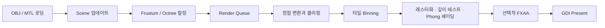

<p align="center">
  <strong>한국어</strong> ·
  <a href="./README.en.md">English</a> ·
  <a href="./README.ja.md">日本語</a>
</p>

# Software Renderer Project

GPU 래스터라이저에 의존하지 않고, 3D 그래픽스 파이프라인을 CPU에서 직접 구현한 Windows용 소프트웨어 렌더러입니다. WinAPI DIB 백버퍼에 픽셀을 기록하고 GDI로 화면에 표시하며, 렌더링 원리와 저수준 최적화를 학습하는 데 초점을 맞췄습니다.

> 개발 기간: 2025-07-07 ~ 2025-08-27<br>
> 핵심 기술: C++26 Preview, WinAPI, SSE/AVX, oneTBB, stb_image

## 바로가기

- [결과 영상과 이미지](#결과-영상과-이미지)
- [주요 기능](#주요-기능)
- [렌더링 파이프라인](#렌더링-파이프라인)
- [빌드 및 실행](#빌드-및-실행)
- [조작 방법](#조작-방법)
- [프로젝트 구조](#프로젝트-구조)
- [설계와 최적화](#설계와-최적화)
- [제한 사항](#제한-사항)

## 결과 영상과 이미지

- [한국어 자막 포트폴리오 영상](https://youtu.be/3StOC1_IjT4)
- [일본어 설명 영상](https://youtu.be/AWwQuzhvvnM)

### 성능 비교

| 최적화 전 | 최적화 후 |
| --- | --- |
|  |  |
| 8 FPS | 58 FPS |

위 수치는 2025-08-27에 기록한 비교 결과입니다. 실제 FPS는 CPU, 해상도, 빌드 구성에 따라 달라집니다.

### 디버그 시각화

| 와이어프레임 | AABB | 법선 벡터 |
| --- | --- | --- |
|  |  |  |

### FXAA

| 적용 전 | 적용 후 |
| --- | --- |
|  |  |

## 주요 기능

| 영역 | 구현 내용 |
| --- | --- |
| 지오메트리 처리 | Model-View-Projection 변환, 백 페이스 컬링, Sutherland–Hodgman 절두체 클리핑 |
| 래스터화 | 삼각형 채우기, 고정소수점 edge function, Bresenham/DDA 선 그리기 |
| 가시성 | 역수 깊이 버퍼, AABB 기반 절두체 컬링, 옥트리 노드 컬링 |
| 셰이딩 | 방향광 기반 Phong 조명, 원근 보정 속성 보간, diffuse 텍스처 샘플링 |
| 에셋 | OBJ/MTL 파서, 삼각형·사각형 face 처리, 누락된 법선 자동 생성, PNG 로딩 |
| 병렬 처리 | 16×16 타일 binning 및 oneTBB 기반 병렬 래스터화 |
| 후처리 | FXAA |
| 디버깅 | 와이어프레임, 법선, AABB, 광원 방향 시각화 |
| 수학 | 자체 벡터·행렬 라이브러리, SSE 연산, 런타임 AVX 디스패치 |
| 플랫폼 | WinAPI 창, GDI DIB 백버퍼, 리사이즈 대응, FPS 표시 |

## 렌더링 파이프라인



렌더 명령은 장면 객체에서 수집됩니다. 화면에 영향을 주는 삼각형은 타일별 bin에 분배되고, 서로 다른 타일을 oneTBB 작업이 병렬 처리합니다. 최종 픽셀은 32-bit DIB 백버퍼에 기록된 뒤 `BitBlt`로 표시됩니다.

## 빌드 및 실행

### 요구 사항

- Windows 10 또는 Windows 11
- Visual Studio 2026와 MSVC v145
- **Desktop development with C++** 워크로드 및 Windows SDK
- C++ 최신 표준 및 표준 라이브러리 모듈 지원

oneTBB 2023.1.0과 stb_image는 `src/ThirdParty`에 포함되어 있어 별도의 패키지 설치는 필요하지 않습니다.

### Visual Studio에서 실행

1. `SoftrendererProject.sln`을 엽니다.
2. 구성을 선택합니다. 일반 실행에는 `Release | x64`를 권장합니다.
3. **Build > Build Solution**을 실행합니다.
4. **Debug > Start Without Debugging**으로 프로그램을 실행합니다.

지원 구성은 `Debug|x64`, `Release|x64`, `Debug|Win32`, `Release|Win32`입니다. 빌드 후 이벤트가 `assets` 폴더와 해당 아키텍처의 `tbb12.dll`을 출력 폴더에 자동 복사합니다.

### 명령줄에서 빌드

Visual Studio의 **Developer PowerShell**에서 다음 명령을 실행합니다.

```powershell
msbuild .\SoftrendererProject.sln /m /p:Configuration=Release /p:Platform=x64
```

## 조작 방법

| 입력 | 동작 |
| --- | --- |
| `W` `A` `S` `D` | 카메라 이동 |
| 마우스 오른쪽 버튼 + 드래그 | 카메라 회전 |
| `Space` | 모델 자동 회전 시작/정지 |
| `F1` | 안티앨리어싱 끄기 |
| `F2` | FXAA 켜기 |

창 상단 메뉴에서는 다음 기능을 추가로 선택할 수 있습니다.

- 선 그리기: Bresenham / DDA
- 안티앨리어싱: None / FXAA
- 디버그 표시: Normal Vector / AABB / Wire Frame / Light Direction

## 프로젝트 구조

```text
SoftwareRendererProject/
├─ assets/                 # OBJ, MTL, texture 에셋
├─ src/
│  ├─ Core/               # WinAPI 애플리케이션과 메인 루프
│  ├─ Graphics/           # Model, Mesh, Material, Texture, Octree
│  ├─ Math/               # SRMath, AABB, Frustum, SSE/AVX 디스패치
│  ├─ Modules/            # sr.math C++ 모듈 인터페이스
│  ├─ Platform/           # 최소 Win32 경계 헤더
│  ├─ Renderer/           # RenderQueue, clipping, tile rasterizer, FXAA
│  ├─ Scene/              # Camera와 GameObject
│  ├─ ThirdParty/         # oneTBB와 stb_image
│  └─ Utils/              # 에러 타입, 고정 용량 컨테이너, 성능 측정
├─ SoftrendererProject.sln
└─ SoftrendererProject.vcxproj
```

## 설계와 최적화

### Modern C++ 적용

| 설계 | 적용 방식 | 목적 |
| --- | --- | --- |
| 비소유 데이터 뷰 | `std::span`, `std::string_view` | 길이와 소유권 계약을 API에 표현 |
| 구조화 오류 | `std::expected<T, AssetLoadError>` | 파서와 WinAPI UI를 분리하고 파일·행 정보를 보존 |
| 예외 없는 숫자 파싱 | `std::from_chars` | 임시 문자열, locale, 예외 비용 제거 |
| 고정 용량 클립 버퍼 | `FixedCapacityVector` / `std::inplace_vector` 호환 경로 | 작은 hot path의 힙 할당 제거 |
| 타입 제약 | C++20 concepts와 `sr.math` named module | 잘못된 타입을 호출 지점에서 진단 |
| 자원 수명 | 이동 전용 `Renderer::GdiBackBuffer` | 선택 객체 복원, bitmap/DC 해제 순서를 RAII로 보장 |
| 타입 안전한 저장소 | `std::array`, ranges, `inline constexpr`, scoped enum | C 배열과 매크로 사용 축소 |

프로젝트는 `/std:c++latest`를 사용합니다. 아직 표준 라이브러리에 없는 C++26 기능은 feature-test macro로 확인하고 동일한 계약의 프로젝트 fallback을 사용합니다.

### SIMD와 멀티스레딩

- 단일 `vec4`와 행렬 연산은 데이터 폭에 맞는 128-bit SSE를 사용합니다.
- 두 `vec4`를 같은 행렬로 변환할 때는 CPU의 AVX/OSXSAVE와 XCR0 상태를 확인한 뒤 256-bit AVX 구현을 선택합니다.
- AVX 코드는 별도 번역 단위에서만 `/arch:AVX`로 컴파일되어 비지원 CPU용 SSE 경로를 유지합니다.
- 정점 결과, 스탬프, 클립 버퍼, 삼각형 풀은 TBB thread-local 저장소를 재사용합니다.
- 화면을 16×16 타일로 나누어 binning과 래스터화 부하를 여러 worker에 분산합니다.
- FXAA는 luminance 생성과 필터링을 별도 병렬 pass로 나누어 동시 쓰기를 피합니다.

### 해결한 문제

- 클리핑 결과 다각형의 정점 순서를 유지하고 triangle fan으로 다시 삼각형화했습니다.
- OBJ에 법선이 없거나 일부만 존재하면 면 법선을 누적해 smooth normal을 생성합니다.
- `v`, `v/vt`, `v//vn`, `v/vt/vn` face 표기를 `from_chars` 기반으로 처리합니다.
- `usemtl` 이름에 콜론이 포함된 모델을 위해 마지막 콜론 뒤 이름으로 재매핑하는 fallback을 제공합니다.
- GDI 핸들과 DIB 선택 객체의 해제 순서를 RAII 객체로 고정했습니다.
- 로더 오류를 `MessageBox`에서 분리해 Framework 경계에서만 사용자 메시지로 변환합니다.

## 제한 사항

- Windows와 MSVC 프로젝트 파일을 대상으로 합니다.
- OBJ face는 삼각형과 사각형을 지원하며, 5개 이상의 정점을 가진 n-gon은 오류로 반환합니다.
- 텍스처 샘플링은 현재 nearest-neighbor와 clamp addressing을 사용합니다.
- 조명은 방향광 기반 Phong 모델을 중심으로 구현되어 있습니다.
- 제공된 FPS는 특정 시점의 비교 자료이며 표준화된 벤치마크 결과가 아닙니다.

## 외부 라이브러리

- [oneTBB 2023.1.0](https://github.com/uxlfoundation/oneTBB): 작업 기반 병렬 처리
- [stb_image](https://github.com/nothings/stb): 이미지 디코딩
